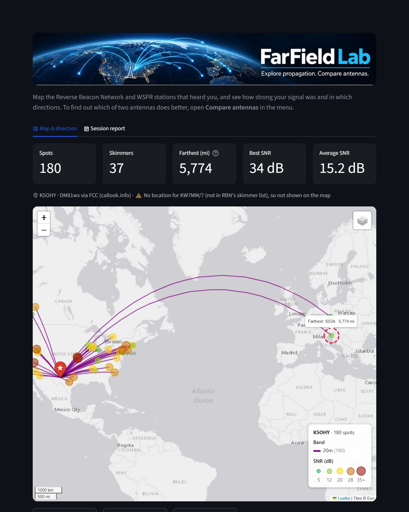
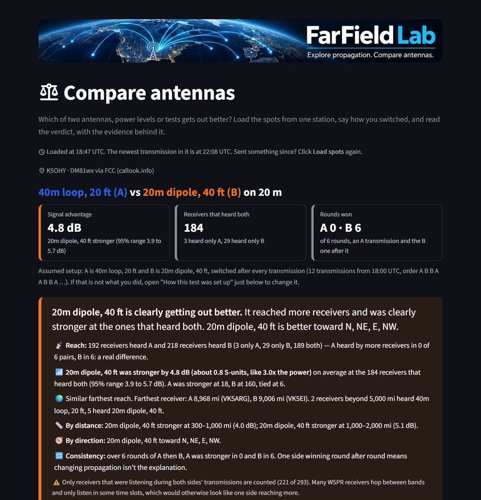
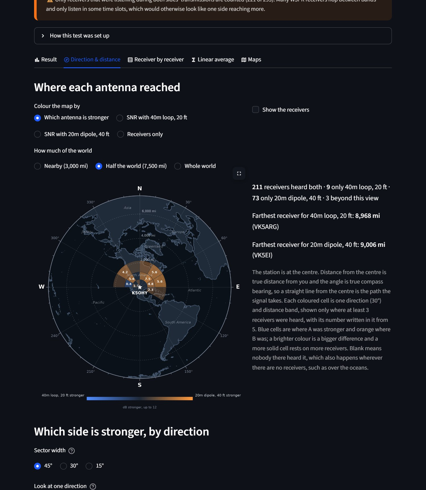
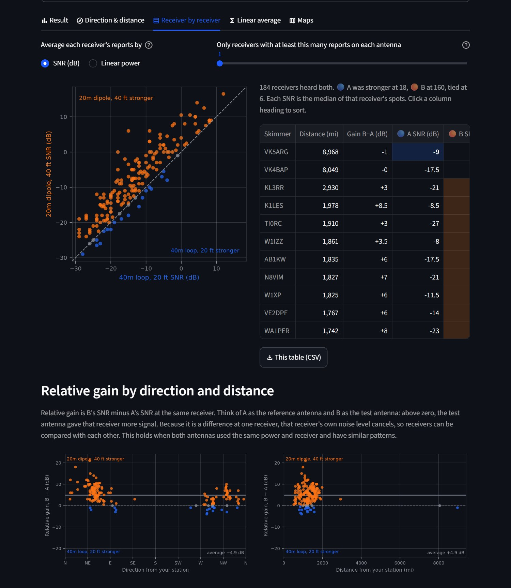
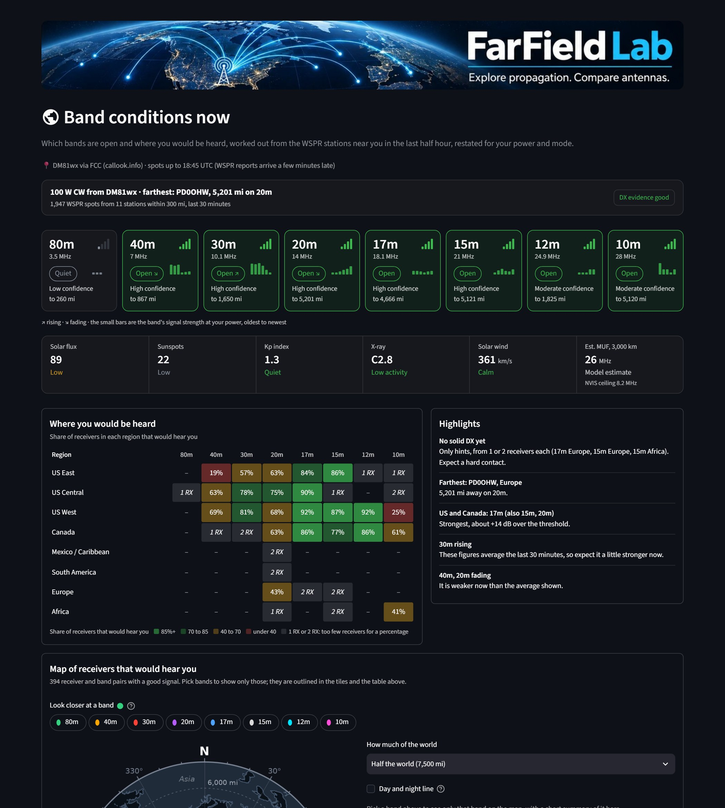
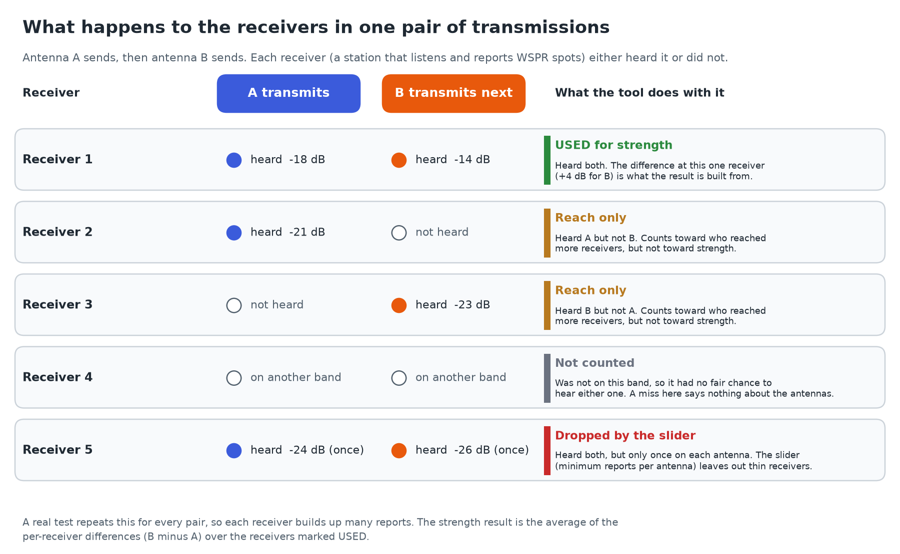

# FarField Lab

**Explore propagation. Compare antennas.**

See where your signal is heard, how strong it is, and how conditions change. Map the [Reverse Beacon Network](https://www.reversebeacon.net/) stations that spotted your CQ, or the [WSPR](https://wsprnet.org/) stations that heard your beacon. Compare which of two antennas, frequencies or power levels is getting out better, using real-world signal measurements. And check which bands are open and where you would be heard right now.

**Jump to:** [Quick start](#quick-start) · [My spots](#the-map) · [Compare antennas](#compare-two-antennas) · [Band conditions](#band-conditions-now) · [Log analysis](#log-analysis) · [Examples](#examples) · [Troubleshooting](#troubleshooting) · [Deep dive](#deep-dive-for-the-curious) · [Run it locally](#run-it-locally)

**Use it online, nothing to install: [farfieldlab.streamlit.app](https://farfieldlab.streamlit.app/)** (the project was called RBN Signal Mapper before; the old addresses still work)

## What it looks like

**The map.** Every station that heard you, with the path to each one coloured by band and the dots coloured by signal strength. This is K5OHY's Reverse Beacon Network spots for 23 October 2025.



**Comparing two antennas.** The rest of these screens are from a real test: K5OHY's WSPR transmitter on 20m on 4 October 2026, 12 transmissions switched between a 40m loop at 20 ft (A) and a 20m dipole at 40 ft (B). The dipole won clearly.

**The summary** is the coloured card at the top, labelled *Summary*, in plain English: who reached more receivers, who was stronger and by how much, and whether changing conditions could explain it. The three tiles above it give the headline numbers, and the *Signal advantage* tile is the summary's strength figure. The tabs below it hold the evidence.



**Where each antenna reached.** A world map centred on the station, coloured by which antenna was stronger toward each direction and distance.



**Receiver by receiver.** Every station that heard both antennas, A's signal against B's, with a sortable table and the relative gain by direction and by distance.



**Band conditions.** Which bands are open now, worked out from the WSPR stations near you in the last half hour.



## Quick start

Open [farfieldlab.streamlit.app](https://farfieldlab.streamlit.app/), or [run it on your own computer](#run-it-locally). Then pick what you want to do:

| I want to… | Open | What you do |
| --- | --- | --- |
| See where I was heard | **My spots** | Type your callsign, pick a day, click **Load spots**. [More](#the-map) |
| Compare two antennas | **Compare antennas** | Load the spots from your test, say how you switched, read the result. [More](#compare-two-antennas) |
| See which bands are open | **Band conditions** | Enter your callsign or grid square, set your power and mode. [More](#band-conditions-now) |
| Make sense of a session | **Log analysis** | Set your power, upload your ADIF log. [More](#log-analysis) |

**Just looking?** My spots has a **Try an example** button, and Compare antennas opens with six real tests: [see the examples](#examples).

**Stuck?** [Troubleshooting](#troubleshooting). **Want the working?** [Deep dive](#deep-dive-for-the-curious).

## Examples

**Just looking? Open an example.** The Compare page opens with six real tests, each set up the way it was run and each labelled with how its antennas were switched:

- **Switched after every transmission:** a 40m loop against a 20m dipole, 12 transmissions, and a quarter-wave vertical against a 2 element vertical on 1 November 2026, 16 transmissions with four in the middle left out (both K5OHY).
- **Long alternating blocks:** Dale's (N3HXZ) nine-hour test of a Performer (tuned elevated quarter-wave) against a 17 ft whip on a 5:1 unun, switched every 30 minutes.
- **Told apart by frequency:** a quick CW check on the Reverse Beacon Network, the same loop and dipole on 14069.5 and 14070.5 kHz (K5OHY).
- **Each antenna has its own callsign:** two short WSPR tests by Callum (M0MCX, DX Commander) on 14 January 2026, a delta loop against a vertical, on 20m and on 40m. A is the antenna that sent first, as in his log: the delta loop (M0MCX) on 20m and the vertical (M0XXT) on 40m. Each is only three pairs of transmissions, so treat them as a demonstration of how the page works and what a short test can and cannot say, not a ruling on the antennas.

## Sharing a view

**Share what you are looking at.** Once spots are loaded, the sidebar shows a link to this view and your browser's address bar holds the same link. Send it to someone and they land on the same callsign, date and band, with the spots already loaded. The same link also brings your sidebar choices back if you refresh the page or your computer sleeps. On the Compare page the link also carries the whole test: the antenna names, how you switched, the start and order, a pasted block schedule, any antenna cells you corrected by hand, and the averaging choices, so the person you send it to sees the same summary.

Free hosting can fall asleep: click the button to wake it. A local copy also remembers your settings in `settings.json`.

## Getting your spots

In the sidebar, choose **Spots from: RBN or WSPR**. For RBN, choose **Download a day** or **Paste spots**.

**RBN, Download a day.** Pick a day or a range (up to 7 days). Works for anything up to yesterday (UTC), because RBN publishes a day's file after that day ends. Only spots of your callsign are kept. On your own computer today works too, because the app collects it while it is open, and where a live collector has been set up (see [collector/SETUP.md](collector/SETUP.md)) it works on the website: its spots come from RBN's live feed, and the page says if the collector began part way through the day or lost its connection, so you know what may be missing.

**RBN, Paste spots.** For spots from the last few minutes or hours, and for quick tests. Look up your callsign on [reversebeacon.net](https://www.reversebeacon.net/), copy the spot rows, paste them into the box, and click Load spots. The app reads each field by what it looks like, so odd spacing is fine.

**WSPR.** Pick a date (today works) and click Load spots. The app looks up WSPR spots sent by the callsign you entered, so use the callsign your WSPR transmitter sends. Reports take about 5 minutes to arrive in full; a newer cycle is still used and marked *may be incomplete*. Click Load spots again to refresh.

WSPR differs from RBN in a few ways: SNR is mostly negative (about -30 to +5 dB), the stations are called receivers, and *Show all skimmers* is off because there is no list of every WSPR receiver.

## The map

- Paths from you to every station that heard you, drawn as great circles and coloured by band.
- Dots sized and coloured by SNR. Click one for every spot from that station. The farthest station is circled.
- Band buttons above the map: **All** (every spot of the day) and one for each band that has spots, so a single click shows just that band. The sidebar filters are the **UTC time window** (one-minute steps) and **Minimum SNR** (RBN). They update the map instantly.
- A **Session report** tab for the whole day, across every band you loaded: when you were heard on each band, a band-by-hour grid (spots, farthest reach or median signal), a band scorecard, and how many stations heard you on each band by region (US East/Central/West, Canada, Europe, Asia and so on). It counts time you were *heard*, not time on the air, because a spot only exists when someone heard you.
- A **World view from your station** below the map: the same azimuthal map, coloured by average SNR or by how many stations heard you in each direction and distance cell.
- Stats above the map, a compass chart of your spots by direction below it, and a sortable spot table.
- **CW speed.** For RBN spots, a **Typical speed** tile (the speed the skimmers measured for your sending, with the range most spots fall in), the speed in each skimmer's popup, and a **Heard by speed** table in the Session report that groups your spots by speed (under 20, 20 to 24, 25 to 29, 30 or more wpm) with the spots, skimmers, bands and median signal of each. It is the skimmers' measurement, not what you set, and only CW spots have one (an RTTY spot's speed is in baud, and WSPR has none). A speed group used on only one band or at one time of day can't be compared fairly with another.
- Map style (light, dark, satellite, street), miles or kilometres, and **Download map** (a standalone HTML file).
- **Download report (PDF)** next to it: key numbers, the session report, direction chart and the stations that heard you.
- A **Log analysis** page in the menu: upload a contact log from your logging program and see it beside your RBN spots and the WSPR stations around you. See below.

Your location comes from the grid you typed, else (for WSPR) the grid square your own spots report, else the RBN skimmer list, else the FCC ([callook.info](https://callook.info)), else [HamDB](https://hamdb.org), else the centre of your country (the app warns you, because a country's centre can be hundreds of km from you). A WSPR station is always placed by the grid in its spots, 6 characters when there is one, so a station outside the US lands where it really is. Enter the grid square where you operate to place the pin somewhere else.

## Log analysis

<!-- help:skip -->
Upload a log from your logging program and see your session beside who heard you.

1. Set the power you ran in the box above the uploader. This page does not read the power from the log, and it starts working the moment a log loads.
2. Upload an ADIF file (most logging programs can export one). Your callsign, grid square and days come from the log.
3. Read down the page. Pick a band under the two maps to compare who spotted you with who you worked.

**You get:** the session in numbers, who followed you from band to band, what you worked (DXCC entities, states, zones), a session chart, two maps (the skimmers that spotted you and the stations you worked), how the bands were doing for DX while you were on, space weather, and for a POTA or SOTA log how your activation compares with the others at that park or summit. The log is used for that visit only and is not saved.

<!-- /help:skip -->

<details>
<summary><b>What does every part of the Log analysis page show?</b></summary>

Open **Log analysis** in the menu, set the power you ran (the box beside the uploader; the page does not read the power from the log, and the calculations start the moment a log is loaded, so set it first), and upload an ADIF file (most logging programs can export one). Everything else comes from the log: your callsign and grid square are filled in from it and shown in one line under the uploader (open *Change the callsign, the place or the nearby radius* if they are wrong), and the days are read from its dates. The page then downloads your RBN spots for those days and fetches the WSPR picture on its own. The log is used for that visit only and is not saved. A log of up to four days is compared. The page leads with the story of the session (who followed you, the session chart, the maps, the band conditions during it, the space weather and who hears whom) and puts the comparison with RBN and the Band conditions page below it. The session chart is drawn from the log at once, and the RBN spots are added to it when they have been read. The strength estimate against a typical WSPR station is in the comparison section, not among the top figures, because it is the most experimental number on the page. RBN makes each UTC day's file at 00:02 UTC the next day, so a log works from then on; before that the page says when it will be ready and shows the facts from the log alone.

- **From the log alone:** contacts, stations, states, an estimated active rate in contacts per hour (a pause of more than 30 minutes is not counted, and a log cannot say when you were actually on the air), the bands you worked, your busiest hour, and the stations that came back on another band. *Who followed you* says how many stations worked you on how many bands ("8 stations worked you on three bands; another 25 on two") and shows each as a row of dots, the most bands first and the number of bands beside the callsign; the first 12 are shown and a *Show more* box under it holds the rest. A line under the file says how many records it read and, if any were left out, why. If the log has more than one grid square or callsign the page warns you, because the comparison uses the one with the most contacts.
- **SOTA logs.** A log made on a summit (the `MY_SOTA_REF` field, or `MY_SIG_INFO` when `MY_SIG` is SOTA) gets the same headline and card, worded for a summit and read from SOTA's public list of the summit and its activations: the summit's points, height, grid square and region, who activated it first, and where your QSOs rank among the activations SOTA lists (by QSOs only, because SOTA does not list modes). Contacts with another summit (the `SOTA_REF` field) are counted in the facts beside *Who followed you*, a reference typed with the letter O for a zero is read as a zero, and only the summit reference is sent to SOTA. The share picture uses the same headline.
- **Share this session.** A collapsed box under the park card makes a sharp 2400 by 1260 picture to post, with your callsign and dates, a title (the park headline for a POTA log), four numbers (contacts, DXCC entities, bands, and US states or continents) and, when the log holds more than one contact, two more: the time on the air and the contacts an hour (the time on the air adds up the stretches between contacts and counts a pause of more than 30 minutes as time off the air; when such a break makes the first-to-last span much longer, by 15 minutes and 10 percent or more, the tile says *on air of* that span, so a long, slow day does not look like a short, fast one; it is logged time, from the contacts), up to three plain lines the number of stations worked on 2 or more bands with the top hunter (the station worked on the most bands, with the bands as colour chips), your farthest contact (call, country, distance and band) and a count of contacts on each band, with the band's colour, in a panel down the left. The rest of the picture is a world map drawn like the page's contact map: your station as a star, a path from it to every place you worked and a diamond there, all in the colour of the band (a place worked on several bands has a diamond for each). The farthest countries are named on the map, and it is zoomed to fit all your contacts. Each place is the centre of the contact's own grid square when the log gives one, else of its state, else of its country. A *Shape* switch draws it for where you will post it, each shape laid out for its own frame and not cropped from another: *Landscape* (2400 by 1260) for X, Facebook and LinkedIn; *Square* (2160 by 2160) for an Instagram or Facebook post; *Portrait* (2160 by 2700, the 4:5 Instagram feed shape); and *Story* (2160 by 3840, 9:16) for Instagram, TikTok and Reels, with the map fading in from clear space at the top and nothing in the top 2.6 and bottom 3.3 inches where those apps put their buttons. In the tall shapes the map is on top and the numbers are in a panel underneath. Twice the usual pixel size keeps it sharp. There are buttons to download it as a PNG, or as a smaller JPG (made when you click), and the same words as plain text to copy. It is made on the page from your log and POTA's list; nothing is saved or sent anywhere, and a link that reopens the page is not possible because the log is never stored.
- **The order of the page.** The numbers and the findings row come first, then *Session overview* (the park or summit card and your rank, the collapsed share box, who worked you on more than one band, the highlights and how fast the contacts came in), *Who heard you* (the session chart and the two maps), *Openings and reach* (the openings and the space weather), *Signal comparison* (who hears whom from the log, then the skimmers against the WSPR stations near you) and *Reference* (what you worked and what is still to work, in one folded box). Each group opens with a heading a link can reach.
- **What you worked.** A second row of tiles under the first four counts the DXCC entities (of 340), the continents (of 6, so a full set is WAC), the US states (of 50, so a full set is WAS, with the Canadian provinces beside it) and the CQ zones (of 40, with the ITU zones beside it). A card below lists each country worked with its contacts and a dot for each band, those outside your home continent first, with the rest under a *Show the other N countries* box, and says how many band-countries there are (each country counted once per band). A collapsed box lists what is still missing: continents, states, provinces and zones. It all comes from the log alone, and says so: it is what is in this log, not what LoTW or the ARRL confirm. The log's DXCC numbers and zones are used when it has them; without them the country comes from the callsign and the zone tile is left out.
- **At a glance.** A row of up to four short findings under the tiles, each a link that jumps to its section: who worked you on more than one band, how many RBN skimmers spotted you and the farthest of them, the sentence that leads the openings, and the signal comparison. A finding appears when it can be made (the RBN ones when the spots have been read); the park or summit card follows the row at once, so it is not repeated in it.
- **Space weather: the flares.** Each flare is a dot sized by class (small grey C and below, amber M, large red X), with its class written beside it for M and X. Hovering a dot gives the class and what it means for HF in NOAA's radio blackout scale (below M is too small to affect HF; M1 to M4.9 is R1, minor; M5 to M9.9 is R2, moderate; X1 is R3, strong; X10 is R4, severe; X20 is R5, extreme), when it began, peaked and ended, the active region NOAA gives, and how many of your contacts the log shows between its beginning and its end (a count only, which says nothing about cause). NOAA keeps its list for about a month, and the lane says so when a session is older.
- **Open this activation on the My spots map.** A button above the RBN maps opens the My spots page in a new tab with your callsign, RBN as the source, the day (or days) of the log and the grid square already set and the spots loading, and, for a log made on one UTC day, the UTC time window from ten minutes before your first contact to ten minutes after your last. The My spots page reads the window from the address (`t0` and `t1`), and a link that narrows the window on that page carries it too.
- **Session highlights.** A card after the countries worked, from the log alone: when each other continent first answered (the station, the band, the time and how far into the session), the farthest contact on each band (marked with a tilde when the contact was placed by its call area, state or country, so the distance is rough), and, only when at least one contact in twenty was with a station already worked on the same band, one line saying so (with how many more were stations that came back on another band, which are your multiband hunters and are shown on their own). When the RBN spots have been read, a folded table beside it gives the first and last RBN spot and the first and last contact on each band, in UTC. Nothing is scored, and a log cannot say when you were calling or listening. **Where a contact was** decides what is called the farthest. A contact is placed, in this order, by its own grid square, by the place of the park or summit it was made from (looked up from POTA or SOTA, only the reference is sent, for a contact with another activator), by the call area or home HamQTH gives a station outside North America, by its state's centre and last by its country's centre. A grid, a park, a summit or a callbook home is a known place; an area, a state or a country is only a centre, which can be hundreds of km from the station, so a centre never wins a farthest-contact ranking by a few km and stations at the same centre are all named, not ranked (two stations in Japan are both at the middle of Japan). When a country is far beyond anything placed precisely (more than 1,500 km) it leads, said to be rough, with the farthest precisely placed contact beside it; a farther country within that margin is mentioned beside the precise contact, which keeps the place. The same placement is used on the maps and in the share picture.
- **How fast the contacts came in.** Under the highlights, two charts on one time axis, so a bar and a line are never read as the same thing. Above, a bar for each ten minutes, as tall as the contacts you made in those ten minutes, stacked by band in the band's colour (no outlines), with a triangle where each band was first used; hovering gives the count on that band and the pace the ten minutes were at on all bands together. Below, a line of the contacts an hour over the hour around each bar, counting only the time on the air (so the start and the end of a session are not read low); a pause of more than 30 minutes breaks the line instead of dipping to zero. One sentence under them names the busiest ten minutes as a *pace* (a short stretch runs hot, so it is not called a rate). It is read from the log alone. A log with a long pause (four hours or more, such as a night between two days) gets one pair of charts for each stretch of activity, side by side, each on its own time axis and as wide as the stretch is long, with its date in the title and the date marked at midnight, so the pause is not drawn as hours of empty bars and 19:00 on one day cannot be taken for 19:00 on the next; the vertical scales are shared so the stretches can be compared. Under the charts are two different measures, never mixed with the estimated active rate on the tiles (which divides by the time on the air): the busiest 60 minutes (a count) and the busiest 10 minutes (a pace), each with its day when the log covers more than one.
- **A picture of the session:** one lane per band, in the order you used them. Each contact is a block, stacked in short time slots (the shortest of 2, 3, 5, 10, 15, 30 or 60 minutes that keeps a block readable is used, and the heading of the lane says which), with the RBN spots for the same slots underneath.
- **Sending speed.** One line under the session chart: the typical CW speed the skimmers measured for your sending and the range most spots fall in, with a note of how it changed only if your fastest and slowest stretches differ by 3 wpm or more. It comes from the RBN spots, because a log does not record CW speed. It is the skimmers' measurement, not what you set.
- **How you used the openings: by destination (the default).** One destination at a time, showing the reported paths and your contacts for it A row of tabs lists only the destinations that have something to show: a path in the nearby WSPR, an RBN skimmer there that spotted you, or a contact with it, each with a short note (*2 contacts · RBN*, or *paths only*), the destination you worked most first. A last tab, *Regional (by direction)*, shows the eight compass directions band by band. The chart leads. Under each day's chart are the plain lines for that day, each about one band and this destination alone (a contact at 17:25 is never read as backed by a path at noon): the lines about bands on which you made contact are written out (at most two), and every other line is folded into one closed line, such as *3 paths with no contact on that band (20m, 15m, 17m)*, which opens to show them. The chart has a strip across the top of your *logged activity* (the band with the most contacts in each quarter hour, with a gap where nothing was logged) and, under it, a lane for each band that has something to show: a bar where the nearby WSPR showed a path (pale for one receiving station), a filled circle for a contact, a hollow triangle where an RBN skimmer there spotted you. A line underneath names what has nothing to show (*Not shown: Asia ...*) and any contact that was inside the distance limit, so it is not counted as DX, by callsign (so a contact that looks missing is explained). *Nearby WSPR shows* (what was decoded, or an estimate for your station: it changes what the WSPR bars mean) is a control above the tabs; the view, the reach and the distance are under *More options*, where the earlier *Band by band* and *Grid* views remain. The details box under the chart opens on the band and window of the first line worth a look (where a path was nearest your contact), the chart outlines that window with a dashed line and says so under the chart, and changing the band or time in the details moves the outline. In a crowded lane the callsigns are on hover, not written beside the circles, so none overlap.
- **How you used the openings: band by band.** The earlier view, under *More options*. A card for each band you worked, highest band first, each on its own time axis in UTC. In a card, a row for each distant continent (Europe, Africa, Asia, Oceania, South America) has a bar for each half hour in which receiving stations there decoded WSPR transmitters near you. A switch chooses what the bars mean: *What WSPR showed* counts the stations that decoded WSPR near you and assumes nothing about your station; *Estimate for my station* counts those whose reports, restated to your power and mode, look strong enough to hear you. **Solid bar:** two or more receiving stations. **Pale bar:** one receiving station. One station is limited evidence, not a weak signal; the count is in the bar's tooltip, and the signal itself is in the evidence below. **Dot:** a contact you made with that continent, with its call and time in the tooltip (nothing is written over the chart, and the calls are listed under the card). **Small tick:** any other contact. **Ring:** an RBN skimmer in that continent spotted you, drawn only where RBN applies (CW or RTTY, while you were calling CQ). **Shading:** logged activity on the band, from the first to the last contact, split where there was a pause of more than 15 minutes. The log holds contacts, so this is when contacts were logged, and says nothing about the time between them. A bin with too little WSPR to say anything (under 3 transmitters or 20 receivers) has no bar and is marked *too little WSPR*, which is not the same as an empty bin. Each card has one finding in words, such as *Worked South America. No corresponding nearby WSPR reports in the selected window.* or *South America paths appeared 20:30-21:00 and 21:30-22:30, outside your logged activity on 10m. Your log shows 12m, 15m and 20m activity then.* A destination box narrows the cards to one continent, and *More options* sets how far away a station must be (3,000 miles or more by default). Time bins are 30 minutes and each is judged on the hour of WSPR up to its end, so a bar shows roughly when a path was there, not the exact moment it opened or closed. Bands you did not work are named under the cards. **When a path appeared** is stated for each destination, not pooled: a contact with Oceania at 20:58 and a nearby WSPR path to Oceania at 22:00 reads *Worked Oceania at 20:58; nearby WSPR showed a path there later (22:00-22:30)*, and *at the time* is said only when a path bin is the contact's own half hour or the one next to it (neighbouring bins share most of their hour of WSPR). Paths to a destination you did not work are said too, even on a band where you worked another. A band you did not work gets a card of its own when the nearby WSPR showed a path (marked *not worked*); a band with no path stays in the line underneath. **Reach** switches the lanes between *DX* (the other continents, never your own: a station in Europe has North America as a destination, found from your callsign) and *Regional* (the eight compass directions, for stations from 500 km out to where DX begins, so most of a North American activation can be read; a direction that stays open the whole time is named in one line and not drawn, and each contact is a dot in its own direction's lane). Your contacts follow the same distance rule as the WSPR stations and the skimmers, so a contact nearer than the distance you set is a small tick, not a dot.
- **Map: where nearby WSPR reached on one band.** A folded box under the openings with a heat map of one band. It shows the receiving stations that decoded the WSPR transmitters near you (as you chose with *Nearby WSPR shows*: what was decoded, or what also looked strong enough for your power), hotter where a place decoded them in more half hours of the session, with your station as a star and your contacts on that band as white dots. Choose the band (it opens on the band of the first line worth a look), whether to use the whole session or only the half hours you logged a contact on the band, and whether to leave out receivers within 500 km, which can hear you by ground wave and would cover the map in heat. A receiver's place is found again from the distance and bearing the page keeps for it. Heat says where a path was reported, not where you could have worked, and a place with no heat may simply have no receiver.
- **How you used the openings: the grid view.** One of two views of the same evidence (switch with *View*; the other is *Band by band*, next). Under the session chart: one sentence that gives the answer, then a grid with a row for each band and a box for each half hour. For the destination you choose, the shading is WSPR path evidence and the marks are you, and the two are never blended into a score. **Choosing a destination:** one list holds all destinations, each continent and each compass direction from you (eight sectors of 45 degrees). It opens on the continent where you made the most DX contacts. *More options* beside it sets how far away a station must be to count (3,000 miles or more by default, 1,000 km or more, or any distance). **The shading** counts the WSPR stations (receivers, not RBN skimmers) in that destination that decoded WSPR transmitters near you (within the radius you pick, 500 km by default) in the hour up to the end of the box. A switch chooses between two named views: *What WSPR showed* assumes nothing about your station; *Estimate for my station* counts those whose reports, restated to the power you entered and the mode most of your contacts were in, look strong enough to hear you, with 3 dB to spare. It counts different stations, not reports. A striped box means stations there decoded WSPR but none looked strong enough; a dashed box with a question mark has too little WSPR behind it to say anything (under 3 transmitters or 20 receivers), which is not the same as a closed band; a blank box has no reports from there. **The marks** are an amber diamond when you were active on the band in that box, a star when you logged a contact with the destination, and a ring when an RBN skimmer there spotted you. RBN speaks only for CW and RTTY, and only while you were calling CQ (a skimmer spots a station that calls, not one that answers), which is known from the kind of your own RBN spots, or from a POTA or SOTA log, which is run by calling; where it does not apply the box says *RBN not applicable or unknown*. A contact counts toward a direction when its own grid square is in the log, or when its state lies wholly in that direction from you; one in a state that spreads over several directions is between them and is left out. **What a box says** is one of five statements: a path and a contact with it; a path and you were active on the band but made no contact with it; a path and no contact on the band; a contact but no path in the WSPR; or no path and no contact. They say what was in the data, in cautious words (*you were active*, never *you caught*), and never what you should have done: there is no score, and nothing is inferred about when anyone was listening or what you tried. Hover over a box for its statement. Under the grid a small table counts the boxes band by band (boxes, boxes you were active in, with a path, with a contact there, with both, and with too little WSPR to say), and the same in words, with how to read the grid and what it rests on, is in the folded *How to read this, and what it rests on*. It needs only WSPR, so it works on the day of the activation, before RBN has published its file. It is an estimate that tends to run high, and counts for different bands are not a fair ranking, because bands have different numbers of stations. The earlier picture, the share of nearby receivers that would hear you, is under "Another view: the percent of stations that could have heard you". RBN has far fewer skimmers than WSPR has receivers, especially outside North America and Europe, so a ring proves you were heard there but no ring says little.
- **The evidence line.** Under the openings grid's heading, a line says how much WSPR it rests on: the reports, the transmitters within the radius you picked, the stations that decoded them and how far away the farthest was. Under 5 transmitters it says the picture is thin.
- **Nearby radius.** Under *Change the callsign, the place or the nearby radius*, under the uploader, it sets how far from you a WSPR transmitter counts as near you: 300, 400 or 500 km (500 by default). A smaller circle is more local and has fewer stations behind it. Changing it starts the calculations again.
- **The openings redraw on their own.** This section is a fragment: choosing a destination, a band, a time or *Nearby WSPR shows* redraws only the section (about two seconds on a long log), not the whole page. It is drawn once the RBN spots have been read, so for the first minute of a new day's file it holds a short note. The *Band openings* card in the row of findings at the top follows the destination on the next full run of the page, not on every tab click.
- **Source key.** Above the destination chart, three boxes say what each mark can establish: your log (you completed a contact with the destination), RBN (a skimmer there decoded your signal) and the nearby WSPR (a receiver there decoded another transmitter near you). The band picked under *Details for one band and time* is ringed on the chart, with its window outlined.
- **Details for one band and time.** A folded section under the chart, the cards or the grid. It looks the WSPR window up only when *Show what is behind this window* is switched on, so changing the band or the time stays quick. Pick a band and a time box (and, in the band-by-band view, a continent) and the page shows everything behind it: the exact WSPR window and how much of it the box before also used, how many reports, transmitters, receivers and sites stand behind it, and four tables: the WSPR transmitters near you with their distances, the receivers in the destination with the times they decoded and whether they looked strong enough, every RBN spot of you on that band in that box (marked as from a skimmer in the destination or not; most are from skimmers near you, which is why the shading and rings count only the distant ones), and your contacts in that box.
- **What each box rests on.** A folded section under the openings. It lists every box with its exact WSPR window, how many minutes of that window the box before used too (each box is judged on the hour of WSPR up to its end, so neighbouring half hours share half of it), the transmitters, receivers and receiving sites behind it, and what it can say: *evidence*, *no reports*, *insufficient coverage* (fewer than 3 transmitters or 20 receivers), *below threshold* (stations reported but none looked strong enough), *unavailable* or *not applicable*. Below it, your contacts by direction from you (eight 45 degree sectors) or by continent. A contact is placed by its own grid square when your log has one; a contact placed only at the centre of its state or country is listed apart and left out of the directions, because that centre can be hundreds of km from the station.
- **Space weather during your session.** Kp in three-hour steps (from GFZ Potsdam), solar flares at their peak (from NOAA, which lists them for about a month, so an older log shows none) and your contacts in the same hours, with lines for the highest Kp, the solar flux and the strongest flare. These are worldwide figures: they say whether something unusual was going on (a storm, a big flare), not what worked near you.
- **Do they hear you as well as you hear them?** From the S in the reports both ways, by band: what they gave you, what you gave them, and the difference in dB (one S-unit is 6 dB). A band needs 10 contacts with a report both ways, and one whose reports are nearly all S9 both ways says little, because many operators send a 9 out of habit. A difference can come from their antenna, noise or habits as easily as from your station, so it is a rough picture, not a measurement.
- **How this park compares (POTA logs).** When the log carries a POTA park (the `MY_POTA_REF` field, or `MY_SIG_INFO` when `MY_SIG` is POTA), the page opens with a headline across the top (for example *The biggest activation listed at the park*, with the day's QSOs against every activation POTA lists and where you stand among the park's activators), then a card under the four tiles. On the left are a small map of the park and what POTA knows about it (what it is and where, its grid square, who activated and hunted it first, how many stations have hunted it, its totals, and a link to its own website). On the right, each UTC day's activation is compared with every activation POTA lists for the park: how many activations and activators it has, how many of them are yours, where your QSOs rank (the most first) by total, CW, phone and data QSOs, where you stand among all the park's activators, and the top activators and biggest activations. It is read from POTA's public activation list, which has only what the activators uploaded, so it can be out of date, and an activation that is not listed under your callsign yet is ranked by the log's own count. Only the park reference is sent to POTA.

- **Park to park (POTA) and summit to summit (SOTA) map.** Under the facts about the park, a map of your park (green) and the other parks the log names for your contacts (amber, with a line to each), with the stations, bands and times on hover and a line saying how many parks and contacts it shows. Only a contact whose log record carries the other station's park (`POTA_REF`, or `SOTA_REF` for a summit) is shown: the log is the only place that says a contact was park to park, so a contact your logging program did not mark is not found, and the caption says how many of the contacts made from the park it covers. A park POTA cannot place is left off the map and counted.
- **The comparison** starts by itself once the log is read; the first time it can take a minute or two, because it reads the RBN files and fetches the WSPR stations within the radius you picked (500 km by default) of you for each stretch on a band. For each band it shows your contacts, how many skimmers spotted you, and how strong the skimmers reported you.

- **Maps.** Under the session chart, headed *Maps for CW* because skimmers only hear CW, two maps of one band appear side by side once the RBN spots have been read, framed on the same area. They open on the band with the most DX contacts; pick another band above them. On the left are the skimmers that spotted you, coloured and sized by SNR. On the right are the stations you worked, as diamonds coloured by the report they gave you (S3 weak and green to S9 strong and red; grey where the log has no report). A black ring marks a station that worked you on more than one band, so the ones that followed you stand out. When the log gives a station's grid square (many logging programs write it), that station is placed from it at once, with no lookup. The other stations of every band are looked up in the background as soon as the log is loaded, busiest band first, so each band's map is usually ready when you pick it (a brand-new log can still take a few seconds per band): a station the log puts in the US is looked up at the FCC ([callook.info](https://callook.info)) and [HamDB](https://hamdb.org), the way your own callsign is, and a station elsewhere with no grid in the log is placed by its call area from [HamQTH.com](https://www.hamqth.com) (or by its home, when the app has a HamQTH key), and at the centre of its country only when HamQTH cannot place it; a station whose record carries a park, a summit or its own coordinates is placed there instead. A home is shown at the centre of its 4 character grid square, never at an address, and each popup says how the station was placed: a logged grid, a park or summit reference, a registered home location (where it operated is not confirmed), or an approximate centre of its call area, state or country. A band that has not been looked up before usually takes well under half a minute; the answers are remembered. *CW contacts only* is ticked by default, because skimmers only hear CW. Choosing another band (or the *CW contacts only* box) redraws only the maps, not the whole page, and a band you have already looked at is kept, so going back to it is instant; the maps stay on the page while the rest of it works.
- **Reports.** Each band row also shows the average S in the reports they gave you on that band. Many operators send a 9 out of habit, so reports are a rough picture of your station, not a measurement, and the page never scores them against the skimmers' SNR.

How to read the band rows:

- **CW contacts and other modes.** Only CW contacts are compared, so a band's row counts those, and says how many other-mode contacts the log has on that band. Bands run from the highest frequency down, so 10m is on top.
- **Against the WSPR reference.** Skimmers that spotted you and are also WSPR receivers are matched. Their reports are set against the WSPR stations near you, restated to your power. Skimmers and WSPR receivers are different equipment, and an ordinary station reads about 10 dB higher on RBN than on the page (found from two checks of stations whose power is known), so that 10 dB is taken off. What is left is a rough hint of how much stronger or weaker than a typical station you were. A band's bar is the middle result of its skimmers, each counted once however many WSPR stations it was matched with; a striped bar means fewer than 8 skimmers. The comparison is its own section, *Signal comparison: RBN skimmers against the nearby WSPR reference*. It opens with what the bars are, an *Experimental* label and the overall result with its matches, different receiving stations and spread; the bars follow, each with its skimmers counted beside it and a scale that marks zero; and the steps, the power, the mode and a worked example are in a folded box under them (*How this estimate works*). Each bar has a line for where the middle half of its skimmers fell, a band that reads 15 dB or more above the reference gets a note (the likely reason is a better antenna than most WSPR stations near you have, and the power to check), and, when at least two skimmers are nearer than 1,500 km (930 miles) and two farther, a line gives the result for each group. The matches are counted two ways: *matches* (a receiving station heard in two stretches of the log, or under two names of one callsign, is a match in each) and *skimmers* (each counted once, which is what the bar and the thresholds use); a folded table lists the receiving stations behind the bars, with the RBN report, the estimate from WSPR and the difference for each. The folded box opens with the idea in plain words (what is matched, what a match and a skimmer are, what the bar and its outline show, and what it cannot tell), then works a bar out in steps, with one real match from your log, and says what power and mode do: the power you enter moves every estimate dB for dB (doubling it adds 3 dB) and so moves every bar the other way, while the mode does not enter the bars at all (it sets only the threshold for *looked strong enough* in the openings).
- The place used is the grid square in your log (or the one you type over it), so a log made portable is compared from where you were.

</details>

## Compare two antennas

Open **Compare antennas** in the menu. It shows three steps: load your spots, say how you switched, and read the result. What you load on **My spots** is already there, and the other way round. Name your antennas under *Name your antennas* if you like.

**For your first test:** use the same transmitter, band and power. Run at least 8 to 12 transmissions, though 16 to 28 is better, switching between transmissions in A, B, B, A order (each antenna gets the same mix of earlier and later turns, so a steady change in the band cancels out). Note the start time, wait about five minutes after the last transmission, then load the spots. Repeat on another day before you trust the result. Shorter tests can be analysed, down to 4 transmissions, but may be inconclusive. More data narrows the uncertainty, and a long test also shows how changing band conditions affect the result. You can also switch after a set time, for example every 10 to 30 minutes (see *How do I run a long-block test?* below). The page tells you how small a difference your number of transmissions can reliably show.

**Reading a result, for example.** In the real example test (a 40m loop against a 20m dipole, 12 transmissions on 20m), the summary says the dipole was stronger by **4.8 dB** (95% range 3.9 to 5.8 dB) at the 158 receivers that heard both antennas, and it won all 6 rounds. Read it like this:

- **How much:** the number and its range. Here the whole range is above zero, so the dipole really was stronger in this test. A range that crosses zero means too close to call.
- **How many receivers:** 158 gives the number weight. A handful of receivers can mislead.
- **How consistent:** the dipole won 6 of 6 rounds. An antenna that wins only some rounds points to changing conditions.
- **What it covers:** this test and the paths it sampled (here toward N, NE, E and NW). It does not mean the dipole is better in every direction or in every condition. Check the direction tab, and repeat the test on another day.

### Recommended WSPR setup

A WSPR transmission lasts about 110 seconds of each 2-minute slot, so there is a short break between transmissions. Flip the antenna switch in that break.

The numbered steps below are for the **After every transmission** option. For **In long blocks**, see *How do I run a long-block test?* below.

1. Connect the transmitter to an A/B coax switch with one antenna on each output. Use one band, one power and one callsign for the whole test.
2. Let the transmitter send in every slot. If it can send an extra packet between cycles (for example a 6-character locator option), turn that off.
3. Wait for the transmission to end, flip the switch, and let the next one start. Go **A, B, B, A, A, B, B, A …** (recommended: each antenna gets the same mix of earlier and later turns, so a steady change in the band cancels out) or **A, B, A, B …** (simpler, but B always goes second), always starting on A. Note the time of the first transmission.
4. Run at least 8 to 12 transmissions (4 to 6 pairs, 16 to 24 minutes); 16 to 28 is better. Eight is a first look at signal strength. It is too few to tell which antenna reached more receivers, because that needs at least 6 pairs where one antenna clearly reached more (pairs that tie don't count), so plan on 16 to 28 transmissions, or more, for small differences or a reach summary.
5. Wait about 5 minutes, pick the date, and click Load spots.
6. Under **Your test**, set **Transmissions in your test** (every 2-minute cycle on either antenna counts: A then B is 2), and **Starting at** if it was not the latest test. It shows how small a difference that many pairs can reliably show. Check the **Order** and the Antenna column match your notes, and read the result. Fix any row, or clear it to leave it out.

For **After every transmission**, use an even number of transmissions: an odd one has no partner and is left out. (In long blocks nothing is paired, so this does not apply.)

<details>
<summary><b>How do I run a long-block test?</b></summary>

**Long tests.** For a long, time-averaged test (one antenna for 30 minutes or an hour, then the other, over several hours), choose **In long blocks** under *Your test*, then give the start time, minutes per block and number of blocks. Every transmission in a block counts for that block's antenna, and each receiver's reports on A and on B are compared as a whole. Aim for 20 or more reports per receiver on each antenna. Shorter blocks of 10 or 20 minutes can work as well: what matters is running enough blocks to get at least 20 reports per antenna at each of enough receivers to see the big picture, and propagation decides how long that takes. You can keep clicking **Load spots** while you collect and watch the **Data used** box (the count of receivers with 20 or more reports on each antenna) to see when enough is enough. The start time can be typed (12:30 or 1230), even if nothing was heard at that minute. The From of each block can be edited in the table (each block ends when the next one starts, so that is all you need; untick the box to set the To times yourself), and for uneven blocks you can paste a schedule, one block per line like `16:40-17:12 A`. A test that runs past midnight UTC needs **Date range** under Period, with To set to the next day; the page says so if the blocks run past the spots loaded.

</details>

### With RBN

Call CQ with the first antenna on one frequency, then with the other antenna on a nearby frequency, back to back (a minute or two apart). Paste the spots and click Load spots. The two biggest frequency groups become A and B; change them with the dropdowns. Skimmers report slightly different frequencies for the same signal, so spots closer than 0.5 kHz count as one (it looks closer if your two tests are nearer than that). RBN is compared by frequency only, because skimmers report a spot a minute or more after you send, which is too blurry to separate A and B by the clock.

Send plenty of CQs on each side, at the same power and speed (or enter the power under **Power**).

### A different way to test: WSPRadar

FarField Lab compares two antennas one after the other: one transmitter, an A/B switch, and the same receivers hearing both. If you can send both antennas at the same time, on two transmitters in the same WSPR cycle, [WSPRadar](https://www.wspradar.org/) by Markus (DL1MKS) is built for that: synchronized, same-cycle benchmarking, with its own method and documentation. The two go about the same job in different ways, so use whichever suits your equipment.

<details>
<summary><b>What happens to each receiver, and why are some left out?</b></summary>

### What happens to each receiver

This section and the picture are for the **After every transmission** option. With **In long blocks** nothing is paired: each receiver's reports on A and on B over all the blocks are compared as a whole. The rules about being on the band, hearing both antennas and the slider's minimum reports still apply.



The picture follows five receivers through one A transmission and the B transmission after it. A receiver that **heard both** antennas, enough times, is **used for strength**: the difference between its two reports is what the result is built from. A receiver that heard only one side counts for **reach** (which antenna was heard by more receivers) but not for strength. A receiver that was not **on the band** (it decoded nothing on this band in your slots) is not counted at all, because a miss from a receiver that was tuned elsewhere says nothing about your antennas. And a receiver that heard both only once is dropped by the **slider** (below), because one report is too thin to trust. A real test repeats this for every pair of transmissions.

</details>

<details>
<summary><b>How long should my test be, and what does the slider do?</b></summary>

### How long should my test be, and what does the slider do?

**The slider** (both options). On the **Receiver by receiver** tab, *Only receivers with at least this many reports on each antenna* sets how many times a receiver must have heard each antenna to count. A receiver that heard you once can be swayed by one lucky report; one that heard you ten times gives a steadier answer. Raising the slider keeps fewer receivers but more trustworthy ones. It also helps with the weak-signal limit: reports near WSPR's decoding floor are never decoded for the weaker antenna, so receivers at the edge make the two antennas look closer together than they are. The switch *Use these settings for the summary and the other tabs too* sends the same setting to the summary and the other tabs.

**Where the slider opens.** On a short test with alternating transmissions it opens at the lowest setting where one more step moves the average gain, and the summary's pair-by-pair figure, by less than 0.25 dB, with at least 30 receivers left. If nothing settles it opens at 2. On a long-blocks test it opens at 20 reports (Dale's method), falling back to 10, 5 or 2 when too few receivers remain. The table *How the result changes as the slider rises*, in the dashboard, shows every setting for a test of up to about 40 transmissions (steps of 5 for a longer one), so you can see for yourself where it settles. The numbers can keep rising as the slider goes up: the receivers dropped first are the weak, far ones, where reports near WSPR's floor are partly missing, which squeezes the gap toward zero.

**The summary and the slider.** For WSPR tests the summary uses the receivers the slider keeps, so the headline and the dashboard count the same receivers. Turn off *Use these settings for the summary and the other tabs too* to make the summary count every receiver that heard both antennas. Either way a line under the summary gives the other number, and *Numbers at a glance* gives both with the reason they differ: the extra receivers were heard only once or twice, so they swing more. RBN tests keep counting every skimmer.

**Has it settled?** Raise the slider one step at a time and watch the average, biggest and smallest gain at the top of the tab. When they stop moving, the result has settled (it has *converged*) and you can trust it more. If they keep moving, the test is too short or too few receivers heard it. Keep at least 5 to 10 receivers: with fewer, a handful of stations decide the answer, and it can look settled only because almost nothing is left. The **Data used** box on the Result tab shows how many receivers each setting leaves.

A long test behaves differently. Because it runs for hours, the band can open or close to different parts of the world during it, so the average gain may keep moving even when you have plenty of reports. If the line has not flattened, look at **One receiver over time** (on the Receiver by receiver tab) before deciding you need more data. Dale finds long tests are usually settled between 20 and 40 reports per antenna at each receiver.

**Looking at part of a long test.** You can analyze any slice of a long test to see how a time of day behaves. In *How this test was set up*, set *First block starts at* to a time when antenna A went on, and *Number of blocks* to the length you want: with 30 minute blocks, 6 blocks is a 3 hour slice. Start each slice where your A, B pattern starts over (any time A goes on for A, B, A, B; every fourth block for A, B, B, A), and use whole A-and-B pairs. A smaller slice has fewer reports per receiver, so lower the slider to match.

**How many transmissions?** This section is for the **After every transmission** option. For **In long blocks**, aim for 20 or more reports per receiver on each antenna (see *Long tests* above). Dale, N3HXZ, ran the same pair of antennas as 16, 12 and 8 transmissions. In his tests:

- Shortening the test changed the average gain much more than the slider did: the shorter the run, the lower and less steady the gain.
- For a small difference of 2 to 3 dB, plan on 16 transmissions or more. Dale has never got a relative gain more accurate than about 1 dB either way, so a difference that small is hard to pin down.
- Keep the slider at or below about half of each antenna's transmissions. With 4 transmissions per antenna, a slider of 4 asks for a receiver that heard every one of them, and none did.
- If the average keeps climbing as you raise the slider and the receivers drop away, it has not settled. More transmissions help more than a higher slider.

**Every transmission, or long blocks?** Switching after every transmission shows one stretch of time; long blocks average over changes in the band, so the two can give different numbers on the same station. In another of Dale's tests, shortening the blocks moved the block result toward the every-transmission one. When the band is changing, which one you run, and when, can matter as much as the antennas. A block can be as short as 2 minutes, which is one transmission: that runs the long block averaging on a test that switched after every transmission, so the two methods can be compared on the same data.

</details>

<details>
<summary><b>What does each results tab show?</b></summary>

### Reading the result

- **The PDF report.** On the **Result** tab, *Download report (PDF)* starts with a **Test setup** section: the transmitter, date and band, how the antennas were switched, the power, and the block table or the list of transmissions, so someone else can repeat the analysis from the report alone. The averaging settings and filters are stated beside the receiver results. The tables can also be downloaded as CSV.
- **Result.** The tab under the summary: a scoreboard, who heard you on each side, and a timeline of every spot in the order it happened. **Download report (PDF)** is at the top of this tab, and a collapsed **Numbers at a glance** box lists the different gain figures side by side with how each is worked out. A collapsed **Data used** box says how many spots and receivers went in (loaded, in the test, compared, and how many have 5, 20 and 40 or more reports on each antenna) and what was left out and why; it is in the PDF too.
- **Direction & distance.** A world map centred on your station (distance from the centre is true distance, angle is true compass bearing), coloured by direction and distance: which antenna is stronger, or the SNR with A or B, or just the receivers (filled where both antennas were heard, open where only one was), so you can see whether an antenna is getting out toward Europe, Asia or Oceania; zoom between nearby, half the world and the whole world. Then a rose chart of how much stronger one side is toward each direction (longer bar means a bigger difference; blue A, orange B; fainter or hatched for fewer receivers; pick 45, 30 or 15 degree sectors, or one direction to see its numbers), the average SNR by direction, and the same by distance range.
- **Receiver by receiver.** Every station that heard both sides, as a chart and a table. The table gives each station's **relative gain** (B's SNR minus A's, so A is the reference and B the test), and two charts plot that gain against direction and against distance. You choose how each station's reports are averaged (SNR in dB, or linear power) and the minimum number of reports a station needs on each antenna, so you can watch the answer settle as the weak, thin stations drop out. Pick one station (sorted A to Z, by distance, by direction or by reports) to see every report from it against time for both antennas, with each antenna's average, the relative gain and its 95% range, which shows fading and band changes at a glance. Under the relative gain charts, a **summary table** gives the average gain by direction (eight octants or four quadrants) and by distance (Short, Medium and Long, with cut points you can change), with the number of receivers and a 95% range for each; it is in the PDF too. For a long-block test, a **Relative gain over time** view averages the gain in windows that are a few block lengths long (20 minutes with 10 minute blocks, 40 with 20 minute blocks) (all stations, with a 95% range, plus the picked station), so a band opening during the test shows up instead of being averaged away. The difference cancels each station's own noise level, so stations can be compared with each other.
- **Linear average.** The standard SNR average next to the same comparison done by averaging power instead of dB (each report turned into power, averaged per antenna, turned back into dB), overall and by direction, with when to use which.
- **Maps.** A's map and B's map side by side.

Differences are always shown as who is ahead and by how much (for example *B +2.0 dB*), never as a negative number.

</details>

### How the comparison works

This section is the short version. The [technical methodology](docs/METHODOLOGY.md) lists every rule and number, how the program was checked (including tests where A and B are the same antenna), and what it does not establish.

<details>
<summary><b>How does the comparison work, step by step?</b></summary>

The idea is simple: ask the same receivers about both antennas, so everything that stays the same for both antennas drops out. A receiver in Germany has its own noise level and its own path to you, and those stable effects are the same for A and B. Conditions that change over time are not the same, which is why the antennas are alternated and why a result is worth repeating on another day. Subtract the receiver's report for A from its report for B and what is left is the difference between the antennas at that receiver. That is the **relative gain** (B minus A, in dB, so A is the reference and B the test; the program works with A minus B internally and shows who is ahead and by how much). Do it for every receiver that heard both and average the results, and you have one number for how much better or worse B is than A, with a 95% range showing how uncertain that number is. WSPR reports move dB for dB with your power as a good approximation, so a difference in transmit power is simply added or subtracted first.

Only receivers that heard both antennas count, only receivers that were on the band during both antennas' transmissions (they decoded other stations in those slots), and every receiver counts on its own, even when several are at one place. The long-test method (relative gain at each receiver, linear-power averaging and long alternating blocks) comes from the work of [Dale, N3HXZ](https://www.n3hxz.net/), who compares antennas this way with WSPR. The quick paired test is this app's own.

The one real choice is how to combine a receiver's several reports on the same antenna. There are two ways:

- **dB, the default for quick tests.** Switch after every transmission. Each A transmission is paired with the B transmission next to it, a minute or two apart, and the dB difference is taken for each pair. A receiver's answer is the middle value of its differences. Because A and B are measured minutes apart, slow changes in the band mostly cancel, and a receiver that heard only a few pairs still counts. This is the right choice for a quick test of 8 to 16 transmissions.
- **Linear power, for long tests.** Run each antenna for a block of 30 minutes to an hour, alternating over several hours. Each report is turned from dB into a power ratio (10 to the power of dB divided by 10), all of a receiver's reports on A are averaged as power, the same for B, and the ratio of the two averages is turned back into dB. This is the arithmetic mean of the decoded signal-to-noise power ratios (it is not received power in watts), and it does not depend on any two particular transmissions matching. It needs many reports per receiver: this app aims for 20 or more on each antenna, and the published method keeps receivers with 40 or more. Alternating blocks help balance band changes (an opening, a fade) between the two antennas, but they can't guarantee it.

Why they can disagree: averaging in dB treats every report as equal (and the app uses the middle value of the dB reports), while averaging power lets the strong reports count for more. For example, reports of 0, 0, 0 and 20 dB have a middle value of 0 dB and a plain dB average of 5 dB, but as power they average to about 14 dB, because the one 20 dB report carries 100 times the power of each of the others. Neither is wrong: they answer different questions, the typical difference versus the difference in average power. More reports generally make the averages steadier, especially when both antennas are tested repeatedly under comparable conditions. Twenty to forty reports per antenna at each receiver is a useful target, but no fixed number guarantees a reliable result.

**A limit on weak signals.** WSPR decodes down to about -28 dB under good conditions. A signal weaker than that is never reported at all, so an average of the reports you do have is not an average of everything that was sent. The app can ignore reports near that floor as a check on how much they matter, but that does not correct for the missing ones. Compare how many receivers heard each antenna as well as how strong they were, especially when one antenna is much weaker.

On the **Linear average** tab, and in the table on **Receiver by receiver**, you can see both answers side by side and change the minimum number of reports a receiver needs. In a long-block test the minimum starts at 20 reports. Under *Leave out some reports or receivers* you can also ignore reports at or below -27 dB (the edge of what WSPR decodes) and leave out receivers closer than a distance you choose, such as ones that could hear you by ground wave; both change the averages on those two tabs, and the summary too while *Use these settings for the summary and the other tabs too* is on (it is on by default for WSPR). A third setting drops a whole station when more than a share you choose of its reports are at the floor, for stations that only hear you at the edge. When at least 3 receivers hear one antenna 20 dB or more stronger than the other (those are the likeliest to have reports at the floor), the page says so and offers that setting at 20% with one click, if it would drop any of them; the Dale N3HXZ suggestion is to start there. If the two agree within 1 dB, that is a useful consistency check, but not independent proof, because both use the same reports. If they disagree substantially, find out why before drawing a conclusion. For a short alternating test the paired dB method is generally preferable. For a longer, well-balanced test the linear-power method is another useful measure, though a few very strong reports can dominate it. Collect more data before believing a small difference. To check that the relative gain has settled, raise the minimum reports a step at a time and watch the biggest and smallest gain: when they stop moving, the result has converged. Keep at least 5 to 10 receivers, because with fewer a handful of stations decide the answer. About 5 or more reports on each antenna is typical, but how many it takes depends on the test (in Dale's studies, a long-block test needed roughly 20 per antenna to get within about 1 dB), so look at the numbers at several settings instead of trusting one.

#### The math, step by step

For each receiver we work out one number: how many dB better (or worse) antenna B did than antenna A at that receiver. We call it **G**, for gain. Then we combine the G values from all the receivers. If B was sent at a different power, its readings are first shifted by that many dB so the antennas are compared at equal power. G measures real-world performance along those paths, not absolute antenna gain. (Inside the program the subtraction is done the other way round, A minus B, and shown as who is ahead and by how much.)

A few words used below. A *reading* is one SNR report in dB. The *middle value* (the median) is what you get when you line the numbers up and pick the one in the middle, so one wild reading can't move it.

**Method 1: the dB way (quick tests)**

1. For each A, B pair of transmissions, subtract A's reading from B's.
2. Line up those differences and take the middle value. That is G.

*Example.* A receiver's five pairs give +4, +6, +5, +20 and +5 dB. Lined up they are 4, 5, 5, 6, 20, so the middle is **+5 dB**. The odd +20 doesn't distort the answer. For long blocks with no pairs, the middle of all B's readings minus the middle of all A's is used instead.

**Method 2: the power way (long tests)**

1. Turn each reading from dB into a power number: 0 dB is 1, 10 dB is 10, 20 dB is 100, and -10 dB is 0.1. (The rule is 10 to the power of dB divided by 10.)
2. Average A's power numbers, and average B's power numbers.
3. Divide B's average by A's average.
4. Turn the answer back into dB. That is G.

*Example.* A's readings are 0, 0, 0 and 20 dB, which are powers 1, 1, 1 and 100, averaging 25.75. B's are 5, 5, 5 and 5 dB, each 3.16, so B averages 3.16. Dividing gives 0.123, which is **-9.1 dB**. A's one loud report dominates, which is why this method needs many reports from each receiver. Even with many reports, it only averages successful decodes: signals too weak to decode are missing from the data (see the note on weak signals above).

**Combining the receivers**

1. Count every receiver on its own, including several at one place.
2. Add up the G values and divide by how many there are.

*Example.* Four receivers give +5, +3, +6 and +2 dB. The total is 16, and 16 divided by 4 is **+4 dB**, so B is about 4 dB better.

**How sure is that number?** The app also gives a 95% range. Suppose B comes out +4 dB stronger with a range of +3 to +5 dB: the whole range is above zero, which is good evidence that B is stronger. If the range ran from -1 to +9 dB, there is too much uncertainty to call a winner. (Strictly, a 95% range means that if you repeated the test many times, about 95 of every 100 ranges built this way would contain the true value, provided the method's assumptions hold.) A side is declared ahead only when the whole range is on its side of zero and the gap is at least 1 dB. A smaller gap is called no meaningful difference, which covers two cases: the whole range sits inside 1 dB, or a lead is probably real but under 1 dB. Neither proves the antennas are identical, and a short test can still be fooled by changing propagation.

</details>

<details>
<summary><b>For the math-minded: the formulas</b></summary>

**Symbols.** For one receiver, $a_1 \dots a_m$ are its readings on antenna A and $b_1 \dots b_n$ its readings on antenna B, all in dB. $G$ is the relative gain, B minus A. $N$ is the number of receivers, and $\Sigma$ means "add up".

**dB method (quick tests).** Each B transmission is paired with the A transmission next to it, round $k$, and the receiver's answer is the middle value of those pair differences:

$$G = \mathrm{median}_k \left( b_k - a_k \right)$$

When blocks are long and there are no pairs, the same idea is used on the whole set: $G = \mathrm{median}(b) - \mathrm{median}(a)$.

**Linear power method (long tests).** Each report is turned into a power ratio, a power average is taken for each antenna, and the ratio is turned back into dB:

$$G = 10 \log_{10} \frac{\frac{1}{n} \sum_{j=1}^{n} 10^{b_j/10}}{\frac{1}{m} \sum_{i=1}^{m} 10^{a_i/10}}$$

Because WSPR reports move dB for dB with transmit power, $G$ is the relative signal-strength advantage of antenna B over A at that receiver, however strong or weak that receiver is.

**Combining receivers.** Every receiver counts on its own, leaving $N$ receivers with gains $G_1 \dots G_N$. The headline number is their mean, each receiver counting equally:

$$\bar{G} = \frac{1}{N} \sum_{r=1}^{N} G_r$$

This gives equal weight to each receiver callsign, not to each place. Receivers at one site share a path and a noise level, so they are not fully independent, and where several share a site the stated range can be narrower than the real uncertainty.

**The 95% range** says how uncertain that average is, and the app uses a few methods depending on the test. For the standard comparison it resamples the receivers (a bootstrap). For an alternating test it also widens that range when needed to allow for fading from one pair of transmissions to the next, which moves every receiver together. For short unpaired tests and for the linear-power check it uses the Student t interval, $\bar{G} \pm t_{0.975,N-1} s/\sqrt{N}$, where $s$ is the standard deviation of the $G_r$ and $t$ is the Student t critical value for $N-1$ degrees of freedom. A range is not a guarantee that the true difference lies inside it.

</details>

<details>
<summary><b>Why do the gain figures differ?</b></summary>

### Which number is which

One test gives several figures that all answer "how much stronger is B?". They are different ways of averaging the same receivers. Signal advantage, Average gain and Typical gain usually land within a few tenths of a dB of each other, more when a few receivers gain far more than the rest. The Power average can sit a dB or more away, because strong reports count for more in power. The **Numbers at a glance** box on the Result tab shows all of them for your test.

| Figure | Where | What it is |
|---|---|---|
| **Signal advantage** | The summary, and a tile on the Receiver by receiver dashboard | The summary's number. For a test that alternates, taken pair by pair: at each receiver only an A transmission and the B one right after it count. The number to quote. |
| **Average gain** | Dashboard, Receiver by receiver tab | Each receiver's middle report on A minus on B over the whole test, including rounds where only one side was heard. It follows that tab's settings, and is Dale's method for long tests. |
| **Typical gain** | Dashboard | The middle receiver, so a few extreme receivers do not pull it. |
| **Power average** | Linear average tab | Each receiver's average power instead of its middle dB report, a cross-check. |

In a long-blocks test there are no pairs, so the Signal advantage and the Average gain are worked out the same way: each receiver's average power on A against B, as in Dale's method.

</details>

### How the summary is decided

<details>
<summary><b>How is the summary decided?</b></summary>

- **Strength.** Only stations that heard both sides count, so each station is its own control. Each station's difference is averaged, with a 95% range. A side wins if the whole range favours it and the gap is at least 1 dB. A smaller gap is called *no meaningful difference*, meaning either that the range sits inside 1 dB or that a lead is real but too small to matter; it does not prove the antennas are identical.
- **Reach.** How many different stations heard each side. For WSPR it is judged one pair of transmissions at a time, because fading on your end moves every receiver together. It needs at least 6 decisive pairs, ones where one antenna reached more stations (ties don't count), so a short test often can't call it.
- **Too close to call** means the data aren't strong enough to separate the antennas. One may look ahead, but ordinary variation could explain the gap, and the summary says how often a lead that size, in that direction, would still appear if the two truly reached equally (for example about 12% of the time). That is not the same as the antennas being equal, and it is not the probability that one is better. For RBN it also says how much more data would settle it.
- **Direction and distance** are only called when at least 4 stations heard both sides there, the gap is at least 2 dB, and a stricter 99% range agrees. With this many sectors checked at once, treat a direction result as a lead to follow up, not a finding.
- **Two ways of averaging.** The dB average and the linear (power) average are explained under *How the comparison works*, above. The **Linear average** tab shows both so you can check that they agree.
- **Fairness.** For WSPR only receivers that were on the band during both sides' transmissions count, and cycles heard by 2 or fewer receivers, or by under 5% of the usual number, are ignored when normal cycles are heard by many more (usually a few receivers with a wrong clock, which also happens in a slot where you skipped a transmission). A cycle with no partner on the other antenna is left out. Power differences are corrected (WSPR carries the power). Every skimmer counts on its own, even several at one place. They see the same sky, so a place with many receivers weighs more in the average. If A and B were sent more than about 10 minutes apart, the summary warns that the time of day could explain the difference.

</details>

## Band conditions now

<!-- help:skip -->
Which bands look open from here right now? Enter your callsign or grid square (or use **My location**), set your power and mode, and read the band tiles. Click a band to look closer. It is an estimate from the WSPR stations near you in the last half hour, restated for your power and mode: a guide good to a few dB, not a promise. A band with no reports is not necessarily closed.
<!-- /help:skip -->

<details>
<summary><b>What is every part of the Band conditions page, and how far can I trust it?</b></summary>

The **Band conditions** page (in the sidebar menu) tells you which bands are open and where a signal like yours would be heard, which helps when you are deciding whether to change band at a park. It takes the WSPR stations transmitting near you (your grid square or callsign, within an area you choose) over the last half hour (or the last hour or two, your choice; a shorter look-back follows a band that is opening or fading more closely), and restates each report for **your power and mode**: SNR moves dB for dB with power, and each mode needs a minimum SNR, so the gap is your margin. The page's link remembers your choices, including that you used **My location** (never the position itself), so a browser refresh or a bookmark opens where you left off and asks the browser for your location again; choosing *Allow* in the browser's site settings, not *Allow this time*, stops it asking. The **Refresh** button beside the spots line, and *Refresh now* in the sidebar, ask wspr.live for the latest spots without reloading the page.

**Look closer at a band.** Under the band tiles, pick one or more bands. They are outlined in the tiles and the table, the map shows only those bands, and a short summary of each (how many receivers heard it, the farthest good one, the best and hardest regions) appears beside the map. With no location entered, **Try an example location** shows the page working.

The page is a dashboard you can read at a glance. A tile for each band shows its status (an arrow means it is rising or fading; **Local only** means the only receivers hearing you are close by, where the ionosphere is not needed, so nothing has skipped yet), how far away the best receiver was, a few small bars for how its signal strength moved over the look-back, and how much data is behind it. A strip below shows the sun and the MUF, each as a number and a one-word reading; the MUF is a model estimate and does not limit what WSPR shows is working. Then comes the region by band grid (cells with only 1 or 2 receivers show the count, not a percentage), a few short highlights, and a map of the receivers that would hear you, with its controls beside it, where you can pick a band or two to show only those and switch on a day and night line (the gray line, where the low bands tend to do best). The detailed tables, the full space weather and MUF explanations, the farthest receivers and how far to trust it all are in tabs at the bottom.

At the top of the page a **Space weather** card shows the sun and Earth's magnetic field right now from NOAA's Space Weather Prediction Center (solar flux and whether it has been rising or falling, the sunspot number, the Kp and A indexes, the X-ray flare level, the solar wind speed and its magnetic field direction, Bz), with a few plain sentences on what they mean for HF. The numbers are worldwide, not your path. The WSPR figures below show recently reported paths involving stations near you (a band with few reports is not necessarily closed); the card explains the why and warns of change. Solar flux is a daily noon reading, the sunspot number and A index are daily values, and Kp covers a 3-hour period. It updates every 15 minutes and disappears if NOAA cannot be reached.

Once your location is known, a **MUF near you** card shows the maximum usable frequency (MUF) for 500, 1,000, 2,000 and 3,000 km paths and foF2, the ceiling for local NVIS contacts, with the highest band under each and a plain reading. It comes from ionosondes, which are small ionospheric radars, collected by GIRO and republished by Andrew KC2G at prop.kc2g.com. Only a few dozen report at any moment (about a dozen good ones worldwide when this was written, three in North America), so the card is an estimate from the nearest working sounders and says how far away they are and how old the readings are. Checked against each other, the nearest working sounder predicted another one's MUF to within about 1.3 MHz (median) and foF2 to within 0.2 MHz when they were within 2,000 km, but a place near the equator, or with no sounder within 3,500 km, is not covered. The 500 to 2,000 km figures are scaled from the measured 3,000 km MUF by the geometry of the hop, so they are rougher still. The card disappears if the feed cannot be reached.

- **Learn from** stations near you, or from **one transmitter**: your own WSPR transmitter, or a friend's. A transmitter at your own location with your own antenna is the closest match to how you will be heard (on 16 Oct every one of K5OHY's 72 contacts fell in a band and region it rated 80% or better, against a median of 61% using nearby stations), though it only shows what that one station was doing. That was a first check on one station on one day, not a calibration.
- A band-by-band table: open, marginal or quiet, whether it is opening or fading, how many receivers would hear you, and the farthest one.
- A region table (US East, Europe, South America and so on) showing the **chance a receiver there hears you** (with how many receivers it rests on), your margin, or the **power you would need** to reach a typical receiver there. The chance allows for the typical error of about 8 dB measured against RBN readings, and a region heard by only one or two receivers is shown greyed as a hint, since in a week of checking, regions like that were really spotted only about 4 times in 10. The **power you would need** view works the same way: it shows how many receivers each figure rests on and greys the ones resting on only one or two, which can look far too easy or too hard. The power box starts at 100 W CW.
- The farthest receivers that would hear you, and a map of them.

**About the percentages.** They are estimates worked out from WSPR reports, your power, the mode thresholds and an assumed error of about 8 dB. They are good for comparing bands and directions, but they are not measured success rates: what you actually hear also depends on your antenna, the receiver's noise and the conditions. They run high for being spotted by an RBN skimmer. Checked against a week (13 to 19 Oct 2026) of four stations' CW activations on RBN (1,436 matches between an RBN skimmer's reading and a WSPR receiver's figure in all), with the local WSPR stations as the data and 100 W assumed because the real powers were not known, the predicted signal strength lined up reasonably well and more margin meant more skimmers spotting them:

| Station | Matches with a WSPR receiver | RBN reading above the WSPR-based figure | Spread |
| --- | --- | --- | --- |
| Station 1 | 749 | +9.0 dB | 7.7 dB |
| Station 2 (20m only) | 106 | +7.0 dB | 6.7 dB |
| Station 3 | 255 | +5.0 dB | 8.6 dB |
| Station 4 | 326 | +2.5 dB | 7.5 dB |

The differences between stations (power, antenna, local noise) are smaller than the spread within each. But of the skimmers the figures said could hear a station, only about 1 in 10 spotted it below the usual RBN spotting level (about 2 dB above the CW figure), 4 in 10 at a margin of 0 to 5 dB over it, 5 in 10 at 5 to 10 dB and about 7 in 10 at 15 dB or more (from the station with the most data), because skimmers are not all listening and the station was not calling CQ the whole time. 30m was the least consistent band, and DX beyond 3,000 miles had too few matches to check. A band marked **opening** is usually a little stronger now than the figures show, since they average the look-back.

It is a guide good to a few dB, not a promise: it only counts receivers that heard the nearby WSPR stations (so with more power than they used you would be heard in more places), WSPR receivers are often quiet sites, and the mode thresholds are approximate. There is a box for how your antenna compares with theirs. The modes are CW, SSB, FT8 and WSPR, each with the SNR it needs. **CW** is the strength a hunter needs to copy you. Being spotted by an RBN skimmer, which is what gets you onto the spotting sites, takes about 2 dB more, because it also needs a skimmer that is listening and you calling CQ. That gap was measured from real CW activations (first two stations, then a week of four stations, see the table above), so it is a guide from a small sample: keep a margin if you want to be spotted. Find yourself by callsign, by grid square (a park, say), or with a **Use my location** button that asks your browser for your position; the area around you can be set in miles or kilometres.

</details>

## Deep dive (for the curious)

This is where the working is.

- **[Technical methodology](docs/METHODOLOGY.md).** Every rule and number, how the program was checked (including tests where A and B are the same antenna), and what it does not establish.
- **[How the comparison works](#compare-two-antennas) and the math, step by step.** Folded away in the Compare antennas section, under *How does the comparison work, step by step?*
- **[Checked against a published study](#checked-against-a-published-study).** How the results compare with published work.
- **[Dale, N3HXZ](https://www.n3hxz.net/).** The long-test method this app's second mode follows.
- **[Files](#files) and [Data sources and thanks](#data-sources-and-thanks).** What each file is for, and where the data comes from.

## Checked against a published study

Dale, N3HXZ, published a long WSPR test of two vertical antennas, "Comparing Performance between an Elevated and a Ground mounted Vertical Antenna" (31 August 2026): a Performer (tuned elevated quarter-wave vertical, two raised radials) against an untuned 17 ft whip on a 5:1 matching unit, ground-mounted with two radials, on 20m at 1 W, switched in 30 minute blocks from 12:00 to 21:30 UTC on 26 August 2026, using the stations with 40 or more spots on each antenna. His table gives each station's relative gain. Loading his transmitter and date, with that schedule, gives the same answers in this program:

- On the 27 stations in the first version of his table, the program's relative gain differs from his by 0.00 dB on average, and by no more than 0.12 dB at any one station.
- The average over 500 to 1,500 miles was 3.87 dB here against 3.86 dB in his table.
- The program also counted four more stations that met the 40-spot rule (ON5KQ, W0AY, WA3TTS and WA7LNW), so the 1,500 to 2,500 mile averages first differed (5.81 dB here against 6.06 dB). His updated paper includes those stations and agrees with this program on which ones qualify.

Open the **Long alternating blocks** example in the app to see it. The example uses 18 blocks (9 hours, to 21:00 UTC) at Dale's request, so its numbers differ a little from his first table, which ran to 21:30. The automated check in `tests/test_dale_study.py` repeats the comparison against the 27 stations of the first version of his table. His article also works out the expected gain by hand from antenna measurements and compares it with the WSPR result, which is worth reading on his site, [n3hxz.net](https://www.n3hxz.net/).

## Run it locally

You need [Python 3.9+](https://www.python.org/downloads/). These steps install the main branch, the version that is live. The `beta` branch has newer changes that are still being tested.

When you run it yourself, days that have already ended are remembered in a folder (in your computer's temporary folder, or the folder named by the `RBN_CACHE_DIR` setting), up to about 400 MB, so loading the same day again does not download it again. Anything from the last hour is always fetched fresh.

**Windows (PowerShell).** Set it up once:

```bash
git clone https://github.com/K5OHY/FarField-Lab.git
cd FarField-Lab
python -m venv .venv
.venv\Scripts\python -m pip install -r requirements.txt
```

Then start it from the project folder:

```bash
.venv\Scripts\streamlit run web.py
```

Use exactly that command. Plain `streamlit run web.py` can fail with "not recognized" unless the virtual environment is activated, because the packages live inside `.venv`. If `python` is not found, try `py -m venv .venv`.

**macOS / Linux.**

```bash
git clone https://github.com/K5OHY/FarField-Lab.git
cd FarField-Lab
python3 -m venv .venv
.venv/bin/python -m pip install -r requirements.txt
.venv/bin/streamlit run web.py
```

Next time, just run the last command again. Open http://localhost:8501 if the browser does not open, and stop the app with Ctrl+C (close the browser tab first if it hangs).

**Today's spots, built in.** While the app is open on your own computer it also listens to RBN's live feed by itself, so My spots can show today. The first time, the sidebar asks for your own callsign to log in with and remembers it (nothing connects until you give it; set `LIVE_RBN_CALL` to give it without being asked), and it only has the spots from when the app started: the page says when it began listening and where it lost its connection, and a restart the same day carries on. The spots are kept for 48 hours in a small file in your local app-data folder (not in the project folder). It is on by default; set `LIVE_RBN_LOCAL=0` to switch it off. To use a collector on another machine instead, set `LIVE_RBN_URL` (see [collector/SETUP.md](collector/SETUP.md)).

The skimmer list refreshes itself every 24 hours, from RBN's node list and, for any skimmer RBN's page could not give (or when it cannot be read from the server), from [HamQTH.com](https://www.hamqth.com)'s copy of it (data provided by HamQTH.com); a skimmer that has since dropped off is kept. To force it: `.venv\Scripts\python rbn_to_csv.py` (macOS/Linux: `.venv/bin/python rbn_to_csv.py`).

## Help inside the app

The **Help and README** page in the app opens with the same four tasks as the home page, then has one tab for each part of this README (My spots, Compare antennas, Band conditions, Log analysis, Troubleshooting, Deep dive), with the long explanations folded closed. The sidebar has a link to the README and code on GitHub.

## Troubleshooting

| What you see | What to do |
| --- | --- |
| "RBN has no data file for ... yet" | RBN publishes a day's file after the UTC day ends. Pick an earlier date, or paste today's spots. |
| "RBN has no spots of ... for that date" | Check the callsign or try another day. |
| "Couldn't read any spot rows" | Copy the rows straight from the RBN spot table. The message quotes the first line it couldn't read. |
| "Couldn't find a location for ..." | Enter your grid square in the sidebar. |
| "No location for ..." under the stats | Those skimmers are in neither RBN's node list nor HamQTH's copy of it, so they are counted but not drawn. |
| Compare found only one frequency group | Your spots are on one frequency, or your two tests were less than 0.1 kHz apart. Use a different frequency for each antenna. |
| A few WSPR cycles show only one or two receivers while the rest show dozens | Usually a few receivers with a wrong clock reporting your signal in the slot where you skipped a transmission. The app leaves those slots out and lists them above the table. If you really transmitted in one (a weak band can do this), pick it under **Count these slots as transmissions**, or every antenna label after it is one step off. |
| "wspr.live seems to be missing most of the reports for ... of your transmissions" | wspr.live's own data has gaps, seen at the start of every hour in some 2024 dates. Spots from those transmissions are undercounted, which can favour the antenna that was on the air at other times. A recent test is not affected. |
| "Not enough data yet" / too close to call | Run more transmissions per antenna (see above). |
| Downloading is slow | A day of RBN data is a large file. Each day in a range is a separate download. Results are cached for an hour. |

## Files

| File | Purpose |
| --- | --- |
| `web.py` | The Streamlit app's entry point: page setup and navigation |
| `views/` | One file per page: `spots_view.py` (My spots), `compare_view.py` (comparing antennas), `conditions_view.py` (Band conditions), `compare_page.py`, `inputs.py` (the sidebar choices and loading both spots pages share), `test_link.py` (a whole test in a link), `help_view.py` (Help and README) |
| `ui_common.py` | Settings, colours, constants and small helpers shared by the pages |
| `data_sources.py` | Getting spots: the RBN download and pasted rows, WSPR from wspr.live, the skimmer list |
| `live_rbn.py` | Today's RBN spots: from a live collector elsewhere (the address is `LIVE_RBN_URL` in the settings), or, when the app runs on your own computer, from a collector it starts inside itself |
| `collector/` | The live collector: `rbn_service.py` stays connected to RBN's live feed on an always-on machine and answers "the spots of this callsign today"; `setup_vm.sh` and `SETUP.md` put it on a free Google Cloud machine; `rbn_listen.py` is a one-off tool that counts the feed's rate |
| `simulate_validation.py` | Simulated tests with a known antenna difference, run through the program's own analysis, to check how often the summary is right, wrong and how often the 95% range holds the truth |
| `docs/METHODOLOGY.md` | The technical methodology: every rule and number behind a summary, how it was checked, and its limits |
| `disk_cache.py` | Remembers days that are over (the RBN file, WSPR spots and who was on the band), so each is fetched once and wspr.live's limit of 20 requests a minute is not used up on repeats |
| `maps.py` | The interactive map of who heard you |
| `charts.py` | The charts and tables for comparisons and the session report |
| `pdfs.py` | Builds the PDF reports from those charts and tables |
| `compare_stats.py` | The A/B maths and the plain-English summary |
| `report_pdf.py` | Lays out the PDF reports |
| `tests/` | Automated checks of the calculations and the pages. Run them with `python run_tests.py` (in parallel: about a minute and a half; `--quick` leaves out the slow Compare page tests, and `python run_tests.py openings core` runs only the tests whose name contains those words) or, one process at a time, `python -m unittest discover -s tests -v`; set `RBN_TEST_NETWORK=1` to include the ones that use the internet |
| `rbn_data.py` | Skimmer list, callsign location lookup, grid conversion |
| `wspr_data.py` | Fetches WSPR spots |
| `world_map.py` | Draws the world map centred on your station |
| `session_report.py` | Builds the session report: timeline, band-by-hour grid, scorecard and regions |
| `conditions.py` | Band conditions: nearby WSPR stations restated for your power and mode |
| `dashboard.py` | The HTML for the Band conditions dashboard: band tiles, sun strip, region grids and highlights |
| `log_check.py`, `log_check_html.py`, `views/log_view.py` | The Log analysis page:
| `space_weather.py` | Current space weather from NOAA and a short plain reading of it |
| `ionosphere.py` | MUF and foF2 near you from the nearest working ionosondes (GIRO data via KC2G) |
| `example_data.py`, `examples/`, `build_examples.py` | The examples open saved copies of the real data (spots, where the station is, and for WSPR who was on the band), so they appear at once; `build_examples.py` refreshes them from the internet |
| `world_land.npz`, `build_world_mask.py` | The land/ocean grid the map is drawn from, and the one-off script that built it |
| `spotter_coords.csv` | Cached skimmer locations (updated automatically) |
| `cty.dat` | Country prefixes from [country-files.com](https://www.country-files.com), for the approximate-location fallback |
| `rbn_to_csv.py` | Refreshes the skimmer list now |
| `Update_spotters.py` | Older helper, not needed |
| `requirements.txt` | Python packages |
| `settings.json` | Your saved settings (local, never committed) |

## Data sources and thanks

Thanks to **Dale, N3HXZ** ([n3hxz.net](https://www.n3hxz.net/)) for the long-test method (relative gain, linear-power averaging and long alternating blocks) behind the Linear average and Relative gain views, and for his testing and feedback.

Space weather comes from [NOAA's Space Weather Prediction Center](https://www.swpc.noaa.gov/). The MUF and foF2 come from ionosonde data collected by [GIRO](https://giro.uml.edu/) (University of Massachusetts Lowell) and republished by Andrew KC2G at [prop.kc2g.com](https://prop.kc2g.com/).

[Natural Earth](https://www.naturalearthdata.com/) (public domain world outlines for the map), [Reverse Beacon Network](https://www.reversebeacon.net/), [wspr.live](https://wspr.live/) and [WSPRnet](https://wsprnet.org/), [callook.info](https://callook.info), [HamDB](https://hamdb.org), [HamQTH.com](https://www.hamqth.com) (data provided by HamQTH.com: where stations outside North America are, by call area, or by home when a HamQTH API key is set as the secret `HAMQTH_API_KEY`), [country-files.com](https://www.country-files.com), Esri and OpenStreetMap map tiles. Built with [Streamlit](https://streamlit.io/), [Folium](https://python-visualization.github.io/folium/), [pandas](https://pandas.pydata.org/), [Matplotlib](https://matplotlib.org/) and [GeographicLib](https://geographiclib.sourceforge.io/).

## License

MIT License.
