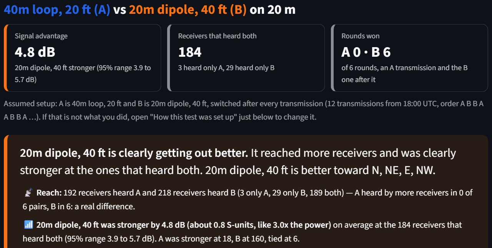

# FarField Lab

**Explore propagation. Compare antennas.**

FarField Lab helps you explore how your station gets out. Map the receivers that reported you, compare two antenna setups, check recent propagation near your location, or explore an operating session from your log.

It uses reception reports from the [Reverse Beacon Network](https://www.reversebeacon.net/) (RBN) and [WSPR](https://wsprnet.org/), alongside your uploaded log when you provide one.

**[Open FarField Lab](https://farfieldlab.streamlit.app/)**. Nothing to install. (It was called RBN Signal Mapper before; the old addresses still work.)

## New here? Start with an example

You can explore these without uploading a file or owning any equipment.

- **[My spots](https://farfieldlab.streamlit.app/spots):** open it and click **Try an example** to explore a real reception map.
- **[Log analysis](https://farfieldlab.streamlit.app/log):** open it and choose an example log. In *My biggest at Bush House*, find the station that worked all five bands, then explore where RBN reported the activation.
- **[Compare antennas](https://farfieldlab.streamlit.app/compare):** open it and choose one of the real antenna tests.

## Or use your own data

| Your goal | Open | What you need | Start by looking at |
|---|---|---|---|
| See where your signal was reported | **[My spots](https://farfieldlab.streamlit.app/spots)** ([guide](docs/my-spots.md)) | Your callsign and a day with RBN or WSPR reports | The map, then the band buttons above it |
| Compare two antennas, frequencies or power levels | **[Compare antennas](https://farfieldlab.streamlit.app/compare)** ([guide](docs/compare-antennas.md)) | Reports from a test where you switched between them, and how you switched | The coloured *Summary* card |
| See which bands look open near you now | **[Band conditions](https://farfieldlab.streamlit.app/conditions)** ([guide](docs/band-conditions.md)) | A callsign or grid square, your power and your mode | The band tiles |
| Make sense of an operating session | **[Log analysis](https://farfieldlab.streamlit.app/log)** ([guide](docs/log-analysis.md)) | An ADIF file (.adi or .adif) exported from your logging program, and the power you used | The row of findings under the numbers |

**Three things that prevent most mistakes**

- **My spots with RBN:** pick a day that has finished (UTC). RBN publishes a day's file after the day ends; the guide explains today's options.
- **Log analysis:** set your power before you upload. The page does not read it from the log.
- **Compare antennas:** check which antenna is A and which is B, and how you switched, before you read the result.

**Do I need a WSPR transmitter?** Not for **Band conditions** or **Log analysis**: they use transmissions from other WSPR stations near your operating location. **My spots** and **Compare antennas** need your own signal to have been reported, either on RBN or from a WSPR transmitter of your own.

*The Summary from a real test: 12 transmissions switched between a 40m loop and a 20m dipole. It gives the signal difference with its 95% range, how many receivers heard each antenna, and how consistently the same antenna won.*

## Understand the three data sources

| Source | What it tells you |
|---|---|
| **Your log** | Who you worked, on which band, and when. |
| **RBN** | Which automated receivers (skimmers) decoded your signal. The log comparison uses your CW contacts. |
| **Nearby WSPR** | Which paths were reported from near your location, by other people's transmissions. It describes the path, not you. |

A logged contact confirms communication between those two stations at that time. An RBN report confirms that a particular receiver decoded your signal. Nearby WSPR adds evidence from other transmitters around your location. Missing reports can reflect gaps in monitoring coverage, so a band with no reports is not necessarily a closed band.

## Help and more detail

- **Help** is in the app's menu, and every page has a *What this page does and how to use it* box.
- **Something looks wrong?** [Troubleshooting](docs/troubleshooting.md)
- **How it is calculated,** including the check against a published study: [Methodology](docs/METHODOLOGY.md)
- **Run it on your own computer, add the optional keys, or contribute:** [Developer guide](docs/developer.md)

## Your data

Your uploaded log is processed for your session and is not saved as a log file by FarField Lab. The app queries external services to retrieve reception reports and to locate stations, using your callsign and, where needed, the callsigns from your contacts. Public lookup results may be cached.

## Credits

The long-test method behind the Compare page follows the work of **Dale, N3HXZ** ([n3hxz.net](https://www.n3hxz.net/)). The full list of data sources and thanks is in the [Developer guide](docs/developer.md#data-sources-and-thanks). MIT License. Made by K5OHY.
