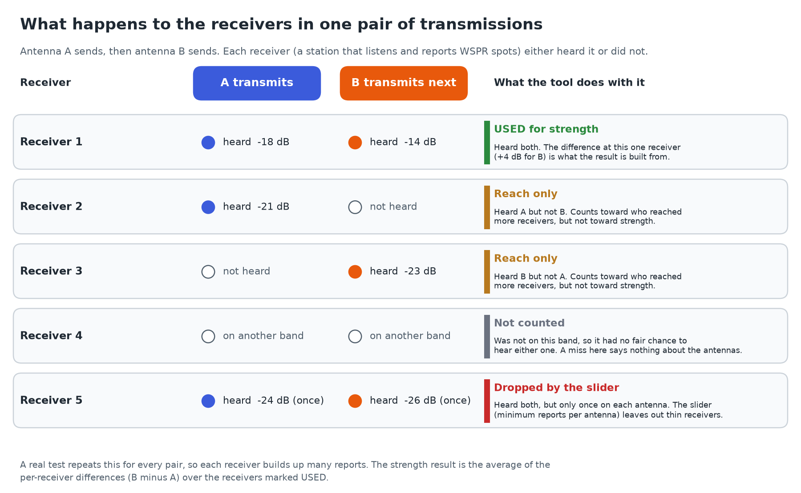

# Compare antennas

## Compare two antennas

Open **Compare antennas** in the menu. It shows three steps: load your spots, say how you switched, and read the result. What you load on **My spots** is already there, and the other way round. Name your antennas under *Name your antennas* if you like.

**For your first test:** use the same transmitter, band and power. Run at least 8 to 12 transmissions, though 16 to 28 is better, switching between transmissions in A, B, B, A order (each antenna gets the same mix of earlier and later turns, so a steady change in the band cancels out). Note the start time, wait about five minutes after the last transmission, then load the spots. Repeat on another day before you trust the result. Shorter tests can be analysed, down to 4 transmissions, but may be inconclusive. More data narrows the uncertainty, and a long test also shows how changing band conditions affect the result. You can also switch after a set time, for example every 10 to 30 minutes (see *How do I run a long-block test?* below). The page tells you how small a difference your number of transmissions can reliably show.

**Reading a result, for example.** In the real example test (a 40m loop against a 20m dipole, 12 transmissions on 20m), the summary says the dipole was stronger by **4.8 dB** (95% range 3.9 to 5.8 dB) at the 158 receivers that heard both antennas, and it won all 6 rounds. Read it like this:

- **How much:** the number and its range. Here the whole range is above zero, so the dipole really was stronger in this test. A range that crosses zero means too close to call.
- **How many receivers:** 158 gives the number weight. A handful of receivers can mislead.
- **How consistent:** the dipole won 6 of 6 rounds. An antenna that wins only some rounds points to changing conditions.
- **What it covers:** this test and the paths it sampled (here toward N, NE, E and NW). It does not mean the dipole is better in every direction or in every condition. Check the direction tab, and repeat the test on another day.

### Recommended WSPR setup

A WSPR transmission lasts about 110 seconds of each 2-minute slot, so there is a short break between transmissions. Flip the antenna switch in that break.

The numbered steps below are for the **After every transmission** option. For **In long blocks**, see *How do I run a long-block test?* below.

1. Connect the transmitter to an A/B coax switch with one antenna on each output. Use one band, one power and one callsign for the whole test.
2. Let the transmitter send in every slot. If it can send an extra packet between cycles (for example a 6-character locator option), turn that off.
3. Wait for the transmission to end, flip the switch, and let the next one start. Go **A, B, B, A, A, B, B, A …** (recommended: each antenna gets the same mix of earlier and later turns, so a steady change in the band cancels out) or **A, B, A, B …** (simpler, but B always goes second), always starting on A. Note the time of the first transmission.
4. Run at least 8 to 12 transmissions (4 to 6 pairs, 16 to 24 minutes); 16 to 28 is better. Eight is a first look at signal strength. It is too few to tell which antenna reached more receivers, because that needs at least 6 pairs where one antenna clearly reached more (pairs that tie don't count), so plan on 16 to 28 transmissions, or more, for small differences or a reach summary.
5. Wait about 5 minutes, pick the date, and click Load spots.
6. Under **Your test**, set **Transmissions in your test** (every 2-minute cycle on either antenna counts: A then B is 2), and **Starting at** if it was not the latest test. It shows how small a difference that many pairs can reliably show. Check the **Order** and the Antenna column match your notes, and read the result. Fix any row, or clear it to leave it out.

For **After every transmission**, use an even number of transmissions: an odd one has no partner and is left out. (In long blocks nothing is paired, so this does not apply.)

<b>How do I run a long-block test?</b>

**Long tests.** For a long, time-averaged test (one antenna for 30 minutes or an hour, then the other, over several hours), choose **In long blocks** under *Your test*, then give the start time, minutes per block and number of blocks. Every transmission in a block counts for that block's antenna, and each receiver's reports on A and on B are compared as a whole. Aim for 20 or more reports per receiver on each antenna. Shorter blocks of 10 or 20 minutes can work as well: what matters is running enough blocks to get at least 20 reports per antenna at each of enough receivers to see the big picture, and propagation decides how long that takes. You can keep clicking **Load spots** while you collect and watch the **Data used** box (the count of receivers with 20 or more reports on each antenna) to see when enough is enough. The start time can be typed (12:30 or 1230), even if nothing was heard at that minute. The From of each block can be edited in the table (each block ends when the next one starts, so that is all you need; untick the box to set the To times yourself), and for uneven blocks you can paste a schedule, one block per line like `16:40-17:12 A`. A test that runs past midnight UTC needs **Date range** under Period, with To set to the next day; the page says so if the blocks run past the spots loaded.

### With RBN

Call CQ with the first antenna on one frequency, then with the other antenna on a nearby frequency, back to back (a minute or two apart). Paste the spots and click Load spots. The two biggest frequency groups become A and B; change them with the dropdowns. Skimmers report slightly different frequencies for the same signal, so spots closer than 0.5 kHz count as one (it looks closer if your two tests are nearer than that). RBN is compared by frequency only, because skimmers report a spot a minute or more after you send, which is too blurry to separate A and B by the clock.

Send plenty of CQs on each side, at the same power and speed (or enter the power under **Power**).

### A different way to test: WSPRadar

FarField Lab compares two antennas one after the other: one transmitter, an A/B switch, and the same receivers hearing both. If you can send both antennas at the same time, on two transmitters in the same WSPR cycle, [WSPRadar](https://www.wspradar.org/) by Markus (DL1MKS) is built for that: synchronized, same-cycle benchmarking, with its own method and documentation. The two go about the same job in different ways, so use whichever suits your equipment.

<b>What happens to each receiver, and why are some left out?</b>

### What happens to each receiver

This section and the picture are for the **After every transmission** option. With **In long blocks** nothing is paired: each receiver's reports on A and on B over all the blocks are compared as a whole. The rules about being on the band, hearing both antennas and the slider's minimum reports still apply.

The picture follows five receivers through one A transmission and the B transmission after it. A receiver that **heard both** antennas, enough times, is **used for strength**: the difference between its two reports is what the result is built from. A receiver that heard only one side counts for **reach** (which antenna was heard by more receivers) but not for strength. A receiver that was not **on the band** (it decoded nothing on this band in your slots) is not counted at all, because a miss from a receiver that was tuned elsewhere says nothing about your antennas. And a receiver that heard both only once is dropped by the **slider** (below), because one report is too thin to trust. A real test repeats this for every pair of transmissions.

<b>How long should my test be, and what does the slider do?</b>

### How long should my test be, and what does the slider do?

**The slider** (both options). On the **Receiver by receiver** tab, *Only receivers with at least this many reports on each antenna* sets how many times a receiver must have heard each antenna to count. A receiver that heard you once can be swayed by one lucky report; one that heard you ten times gives a steadier answer. Raising the slider keeps fewer receivers but more trustworthy ones. It also helps with the weak-signal limit: reports near WSPR's decoding floor are never decoded for the weaker antenna, so receivers at the edge make the two antennas look closer together than they are. The switch *Use these settings for the summary and the other tabs too* sends the same setting to the summary and the other tabs.

**Where the slider opens.** On a short test with alternating transmissions it opens at the lowest setting where one more step moves the average gain, and the summary's pair-by-pair figure, by less than 0.25 dB, with at least 30 receivers left. If nothing settles it opens at 2. On a long-blocks test it opens at 20 reports (Dale's method), falling back to 10, 5 or 2 when too few receivers remain. The table *How the result changes as the slider rises*, in the dashboard, shows every setting for a test of up to about 40 transmissions (steps of 5 for a longer one), so you can see for yourself where it settles. The numbers can keep rising as the slider goes up: the receivers dropped first are the weak, far ones, where reports near WSPR's floor are partly missing, which squeezes the gap toward zero.

**The summary and the slider.** For WSPR tests the summary uses the receivers the slider keeps, so the headline and the dashboard count the same receivers. Turn off *Use these settings for the summary and the other tabs too* to make the summary count every receiver that heard both antennas. Either way a line under the summary gives the other number, and *Numbers at a glance* gives both with the reason they differ: the extra receivers were heard only once or twice, so they swing more. RBN tests keep counting every skimmer.

**Has it settled?** Raise the slider one step at a time and watch the average, biggest and smallest gain at the top of the tab. When they stop moving, the result has settled (it has *converged*) and you can trust it more. If they keep moving, the test is too short or too few receivers heard it. Keep at least 5 to 10 receivers: with fewer, a handful of stations decide the answer, and it can look settled only because almost nothing is left. The **Data used** box on the Result tab shows how many receivers each setting leaves.

A long test behaves differently. Because it runs for hours, the band can open or close to different parts of the world during it, so the average gain may keep moving even when you have plenty of reports. If the line has not flattened, look at **One receiver over time** (on the Receiver by receiver tab) before deciding you need more data. Dale finds long tests are usually settled between 20 and 40 reports per antenna at each receiver.

**Looking at part of a long test.** You can analyze any slice of a long test to see how a time of day behaves. In *How this test was set up*, set *First block starts at* to a time when antenna A went on, and *Number of blocks* to the length you want: with 30 minute blocks, 6 blocks is a 3 hour slice. Start each slice where your A, B pattern starts over (any time A goes on for A, B, A, B; every fourth block for A, B, B, A), and use whole A-and-B pairs. A smaller slice has fewer reports per receiver, so lower the slider to match.

**How many transmissions?** This section is for the **After every transmission** option. For **In long blocks**, aim for 20 or more reports per receiver on each antenna (see *Long tests* above). Dale, N3HXZ, ran the same pair of antennas as 16, 12 and 8 transmissions. In his tests:

- Shortening the test changed the average gain much more than the slider did: the shorter the run, the lower and less steady the gain.
- For a small difference of 2 to 3 dB, plan on 16 transmissions or more. Dale has never got a relative gain more accurate than about 1 dB either way, so a difference that small is hard to pin down.
- Keep the slider at or below about half of each antenna's transmissions. With 4 transmissions per antenna, a slider of 4 asks for a receiver that heard every one of them, and none did.
- If the average keeps climbing as you raise the slider and the receivers drop away, it has not settled. More transmissions help more than a higher slider.

**Every transmission, or long blocks?** Switching after every transmission shows one stretch of time; long blocks average over changes in the band, so the two can give different numbers on the same station. In another of Dale's tests, shortening the blocks moved the block result toward the every-transmission one. When the band is changing, which one you run, and when, can matter as much as the antennas. A block can be as short as 2 minutes, which is one transmission: that runs the long block averaging on a test that switched after every transmission, so the two methods can be compared on the same data.

<b>What does each results tab show?</b>

### Reading the result

- **The PDF report.** On the **Result** tab, *Download report (PDF)* starts with a **Test setup** section: the transmitter, date and band, how the antennas were switched, the power, and the block table or the list of transmissions, so someone else can repeat the analysis from the report alone. The averaging settings and filters are stated beside the receiver results. The tables can also be downloaded as CSV.
- **Result.** The tab under the summary: a scoreboard, who heard you on each side, and a timeline of every spot in the order it happened. **Download report (PDF)** is at the top of this tab, and a collapsed **Numbers at a glance** box lists the different gain figures side by side with how each is worked out. A collapsed **Data used** box says how many spots and receivers went in (loaded, in the test, compared, and how many have 5, 20 and 40 or more reports on each antenna) and what was left out and why; it is in the PDF too.
- **Direction & distance.** A world map centred on your station (distance from the centre is true distance, angle is true compass bearing), coloured by direction and distance: which antenna is stronger, or the SNR with A or B, or just the receivers (filled where both antennas were heard, open where only one was), so you can see whether an antenna is getting out toward Europe, Asia or Oceania; zoom between nearby, half the world and the whole world. Then a rose chart of how much stronger one side is toward each direction (longer bar means a bigger difference; blue A, orange B; fainter or hatched for fewer receivers; pick 45, 30 or 15 degree sectors, or one direction to see its numbers), the average SNR by direction, and the same by distance range.
- **Receiver by receiver.** Every station that heard both sides, as a chart and a table. The table gives each station's **relative gain** (B's SNR minus A's, so A is the reference and B the test), and two charts plot that gain against direction and against distance. You choose how each station's reports are averaged (SNR in dB, or linear power) and the minimum number of reports a station needs on each antenna, so you can watch the answer settle as the weak, thin stations drop out. Pick one station (sorted A to Z, by distance, by direction or by reports) to see every report from it against time for both antennas, with each antenna's average, the relative gain and its 95% range, which shows fading and band changes at a glance. Under the relative gain charts, a **summary table** gives the average gain by direction (eight octants or four quadrants) and by distance (Short, Medium and Long, with cut points you can change), with the number of receivers and a 95% range for each; it is in the PDF too. For a long-block test, a **Relative gain over time** view averages the gain in windows that are a few block lengths long (20 minutes with 10 minute blocks, 40 with 20 minute blocks) (all stations, with a 95% range, plus the picked station), so a band opening during the test shows up instead of being averaged away. The difference cancels each station's own noise level, so stations can be compared with each other.
- **Linear average.** The standard SNR average next to the same comparison done by averaging power instead of dB (each report turned into power, averaged per antenna, turned back into dB), overall and by direction, with when to use which.
- **Maps.** A's map and B's map side by side.

Differences are always shown as who is ahead and by how much (for example *B +2.0 dB*), never as a negative number.

### How the comparison works

This section is the short version. The [technical methodology](METHODOLOGY.md) lists every rule and number, how the program was checked (including tests where A and B are the same antenna), and what it does not establish.

<b>How does the comparison work, step by step?</b>

The idea is simple: ask the same receivers about both antennas, so everything that stays the same for both antennas drops out. A receiver in Germany has its own noise level and its own path to you, and those stable effects are the same for A and B. Conditions that change over time are not the same, which is why the antennas are alternated and why a result is worth repeating on another day. Subtract the receiver's report for A from its report for B and what is left is the difference between the antennas at that receiver. That is the **relative gain** (B minus A, in dB, so A is the reference and B the test; the program works with A minus B internally and shows who is ahead and by how much). Do it for every receiver that heard both and average the results, and you have one number for how much better or worse B is than A, with a 95% range showing how uncertain that number is. WSPR reports move dB for dB with your power as a good approximation, so a difference in transmit power is simply added or subtracted first.

Only receivers that heard both antennas count, only receivers that were on the band during both antennas' transmissions (they decoded other stations in those slots), and every receiver counts on its own, even when several are at one place. The long-test method (relative gain at each receiver, linear-power averaging and long alternating blocks) comes from the work of [Dale, N3HXZ](https://www.n3hxz.net/), who compares antennas this way with WSPR. The quick paired test is this app's own.

The one real choice is how to combine a receiver's several reports on the same antenna. There are two ways:

- **dB, the default for quick tests.** Switch after every transmission. Each A transmission is paired with the B transmission next to it, a minute or two apart, and the dB difference is taken for each pair. A receiver's answer is the middle value of its differences. Because A and B are measured minutes apart, slow changes in the band mostly cancel, and a receiver that heard only a few pairs still counts. This is the right choice for a quick test of 8 to 16 transmissions.
- **Linear power, for long tests.** Run each antenna for a block of 30 minutes to an hour, alternating over several hours. Each report is turned from dB into a power ratio (10 to the power of dB divided by 10), all of a receiver's reports on A are averaged as power, the same for B, and the ratio of the two averages is turned back into dB. This is the arithmetic mean of the decoded signal-to-noise power ratios (it is not received power in watts), and it does not depend on any two particular transmissions matching. It needs many reports per receiver: this app aims for 20 or more on each antenna, and the published method keeps receivers with 40 or more. Alternating blocks help balance band changes (an opening, a fade) between the two antennas, but they can't guarantee it.

Why they can disagree: averaging in dB treats every report as equal (and the app uses the middle value of the dB reports), while averaging power lets the strong reports count for more. For example, reports of 0, 0, 0 and 20 dB have a middle value of 0 dB and a plain dB average of 5 dB, but as power they average to about 14 dB, because the one 20 dB report carries 100 times the power of each of the others. Neither is wrong: they answer different questions, the typical difference versus the difference in average power. More reports generally make the averages steadier, especially when both antennas are tested repeatedly under comparable conditions. Twenty to forty reports per antenna at each receiver is a useful target, but no fixed number guarantees a reliable result.

**A limit on weak signals.** WSPR decodes down to about -28 dB under good conditions. A signal weaker than that is never reported at all, so an average of the reports you do have is not an average of everything that was sent. The app can ignore reports near that floor as a check on how much they matter, but that does not correct for the missing ones. Compare how many receivers heard each antenna as well as how strong they were, especially when one antenna is much weaker.

On the **Linear average** tab, and in the table on **Receiver by receiver**, you can see both answers side by side and change the minimum number of reports a receiver needs. In a long-block test the minimum starts at 20 reports. Under *Leave out some reports or receivers* you can also ignore reports at or below -27 dB (the edge of what WSPR decodes) and leave out receivers closer than a distance you choose, such as ones that could hear you by ground wave; both change the averages on those two tabs, and the summary too while *Use these settings for the summary and the other tabs too* is on (it is on by default for WSPR). A third setting drops a whole station when more than a share you choose of its reports are at the floor, for stations that only hear you at the edge. When at least 3 receivers hear one antenna 20 dB or more stronger than the other (those are the likeliest to have reports at the floor), the page says so and offers that setting at 20% with one click, if it would drop any of them; the Dale N3HXZ suggestion is to start there. If the two agree within 1 dB, that is a useful consistency check, but not independent proof, because both use the same reports. If they disagree substantially, find out why before drawing a conclusion. For a short alternating test the paired dB method is generally preferable. For a longer, well-balanced test the linear-power method is another useful measure, though a few very strong reports can dominate it. Collect more data before believing a small difference. To check that the relative gain has settled, raise the minimum reports a step at a time and watch the biggest and smallest gain: when they stop moving, the result has converged. Keep at least 5 to 10 receivers, because with fewer a handful of stations decide the answer. About 5 or more reports on each antenna is typical, but how many it takes depends on the test (in Dale's studies, a long-block test needed roughly 20 per antenna to get within about 1 dB), so look at the numbers at several settings instead of trusting one.

#### The math, step by step

For each receiver we work out one number: how many dB better (or worse) antenna B did than antenna A at that receiver. We call it **G**, for gain. Then we combine the G values from all the receivers. If B was sent at a different power, its readings are first shifted by that many dB so the antennas are compared at equal power. G measures real-world performance along those paths, not absolute antenna gain. (Inside the program the subtraction is done the other way round, A minus B, and shown as who is ahead and by how much.)

A few words used below. A *reading* is one SNR report in dB. The *middle value* (the median) is what you get when you line the numbers up and pick the one in the middle, so one wild reading can't move it.

**Method 1: the dB way (quick tests)**

1. For each A, B pair of transmissions, subtract A's reading from B's.
2. Line up those differences and take the middle value. That is G.

*Example.* A receiver's five pairs give +4, +6, +5, +20 and +5 dB. Lined up they are 4, 5, 5, 6, 20, so the middle is **+5 dB**. The odd +20 doesn't distort the answer. For long blocks with no pairs, the middle of all B's readings minus the middle of all A's is used instead.

**Method 2: the power way (long tests)**

1. Turn each reading from dB into a power number: 0 dB is 1, 10 dB is 10, 20 dB is 100, and -10 dB is 0.1. (The rule is 10 to the power of dB divided by 10.)
2. Average A's power numbers, and average B's power numbers.
3. Divide B's average by A's average.
4. Turn the answer back into dB. That is G.

*Example.* A's readings are 0, 0, 0 and 20 dB, which are powers 1, 1, 1 and 100, averaging 25.75. B's are 5, 5, 5 and 5 dB, each 3.16, so B averages 3.16. Dividing gives 0.123, which is **-9.1 dB**. A's one loud report dominates, which is why this method needs many reports from each receiver. Even with many reports, it only averages successful decodes: signals too weak to decode are missing from the data (see the note on weak signals above).

**Combining the receivers**

1. Count every receiver on its own, including several at one place.
2. Add up the G values and divide by how many there are.

*Example.* Four receivers give +5, +3, +6 and +2 dB. The total is 16, and 16 divided by 4 is **+4 dB**, so B is about 4 dB better.

**How sure is that number?** The app also gives a 95% range. Suppose B comes out +4 dB stronger with a range of +3 to +5 dB: the whole range is above zero, which is good evidence that B is stronger. If the range ran from -1 to +9 dB, there is too much uncertainty to call a winner. (Strictly, a 95% range means that if you repeated the test many times, about 95 of every 100 ranges built this way would contain the true value, provided the method's assumptions hold.) A side is declared ahead only when the whole range is on its side of zero and the gap is at least 1 dB. A smaller gap is called no meaningful difference, which covers two cases: the whole range sits inside 1 dB, or a lead is probably real but under 1 dB. Neither proves the antennas are identical, and a short test can still be fooled by changing propagation.

<b>For the math-minded: the formulas</b>

**Symbols.** For one receiver, $a_1 \dots a_m$ are its readings on antenna A and $b_1 \dots b_n$ its readings on antenna B, all in dB. $G$ is the relative gain, B minus A. $N$ is the number of receivers, and $\Sigma$ means "add up".

**dB method (quick tests).** Each B transmission is paired with the A transmission next to it, round $k$, and the receiver's answer is the middle value of those pair differences:

$$G = \mathrm{median}_k \left( b_k - a_k \right)$$

When blocks are long and there are no pairs, the same idea is used on the whole set: $G = \mathrm{median}(b) - \mathrm{median}(a)$.

**Linear power method (long tests).** Each report is turned into a power ratio, a power average is taken for each antenna, and the ratio is turned back into dB:

$$G = 10 \log_{10} \frac{\frac{1}{n} \sum_{j=1}^{n} 10^{b_j/10}}{\frac{1}{m} \sum_{i=1}^{m} 10^{a_i/10}}$$

Because WSPR reports move dB for dB with transmit power, $G$ is the relative signal-strength advantage of antenna B over A at that receiver, however strong or weak that receiver is.

**Combining receivers.** Every receiver counts on its own, leaving $N$ receivers with gains $G_1 \dots G_N$. The headline number is their mean, each receiver counting equally:

$$\bar{G} = \frac{1}{N} \sum_{r=1}^{N} G_r$$

This gives equal weight to each receiver callsign, not to each place. Receivers at one site share a path and a noise level, so they are not fully independent, and where several share a site the stated range can be narrower than the real uncertainty.

**The 95% range** says how uncertain that average is, and the app uses a few methods depending on the test. For the standard comparison it resamples the receivers (a bootstrap). For an alternating test it also widens that range when needed to allow for fading from one pair of transmissions to the next, which moves every receiver together. For short unpaired tests and for the linear-power check it uses the Student t interval, $\bar{G} \pm t_{0.975,N-1} s/\sqrt{N}$, where $s$ is the standard deviation of the $G_r$ and $t$ is the Student t critical value for $N-1$ degrees of freedom. A range is not a guarantee that the true difference lies inside it.

<b>Why do the gain figures differ?</b>

### Which number is which

One test gives several figures that all answer "how much stronger is B?". They are different ways of averaging the same receivers. Signal advantage, Average gain and Typical gain usually land within a few tenths of a dB of each other, more when a few receivers gain far more than the rest. The Power average can sit a dB or more away, because strong reports count for more in power. The **Numbers at a glance** box on the Result tab shows all of them for your test.

| Figure | Where | What it is |
|---|---|---|
| **Signal advantage** | The summary, and a tile on the Receiver by receiver dashboard | The summary's number. For a test that alternates, taken pair by pair: at each receiver only an A transmission and the B one right after it count. The number to quote. |
| **Average gain** | Dashboard, Receiver by receiver tab | Each receiver's middle report on A minus on B over the whole test, including rounds where only one side was heard. It follows that tab's settings, and is Dale's method for long tests. |
| **Typical gain** | Dashboard | The middle receiver, so a few extreme receivers do not pull it. |
| **Power average** | Linear average tab | Each receiver's average power instead of its middle dB report, a cross-check. |

In a long-blocks test there are no pairs, so the Signal advantage and the Average gain are worked out the same way: each receiver's average power on A against B, as in Dale's method.

### How the summary is decided

<b>How is the summary decided?</b>

- **Strength.** Only stations that heard both sides count, so each station is its own control. Each station's difference is averaged, with a 95% range. A side wins if the whole range favours it and the gap is at least 1 dB. A smaller gap is called *no meaningful difference*, meaning either that the range sits inside 1 dB or that a lead is real but too small to matter; it does not prove the antennas are identical.
- **Reach.** How many different stations heard each side. For WSPR it is judged one pair of transmissions at a time, because fading on your end moves every receiver together. It needs at least 6 decisive pairs, ones where one antenna reached more stations (ties don't count), so a short test often can't call it.
- **Too close to call** means the data aren't strong enough to separate the antennas. One may look ahead, but ordinary variation could explain the gap, and the summary says how often a lead that size, in that direction, would still appear if the two truly reached equally (for example about 12% of the time). That is not the same as the antennas being equal, and it is not the probability that one is better. For RBN it also says how much more data would settle it.
- **Direction and distance** are only called when at least 4 stations heard both sides there, the gap is at least 2 dB, and a stricter 99% range agrees. With this many sectors checked at once, treat a direction result as a lead to follow up, not a finding.
- **Two ways of averaging.** The dB average and the linear (power) average are explained under *How the comparison works*, above. The **Linear average** tab shows both so you can check that they agree.
- **Fairness.** For WSPR only receivers that were on the band during both sides' transmissions count, and cycles heard by 2 or fewer receivers, or by under 5% of the usual number, are ignored when normal cycles are heard by many more (usually a few receivers with a wrong clock, which also happens in a slot where you skipped a transmission). A cycle with no partner on the other antenna is left out. Power differences are corrected (WSPR carries the power). Every skimmer counts on its own, even several at one place. They see the same sky, so a place with many receivers weighs more in the average. If A and B were sent more than about 10 minutes apart, the summary warns that the time of day could explain the difference.

